---
# GENERATED BY _prerender.py FROM lecture-6-multi.qmd - DO NOT EDIT
title:  Causal Inference and Randomized Experiments
subtitle: "Lecture 6 (R code)"
format:
  pdf:
    toc: true
    output-file: lecture-6-notes-R.pdf
engine: knitr
multi-lang: r
lang-r: true
---
```{r}
#| include: false
#| cache: false

library(Statamarkdown)
knitr::opts_chunk$set(collectcode = TRUE)
```

```{r}
#| include: false

# Packages
library(haven)    
library(ggplot2)

source(here::here("config.R"))

```

```{stata}
*| include: false

do "config.do"
```

::: {.content-visible unless-format="revealjs"}

## Reading

This lecture covers material from @wooldridge2025:

- Chapter 2.7 "Regression on a Binary Explanatory Variable"
  - Chapter 2.7a "Counterfactual (or Potential) Outcomes, Causality, and Policy Analysis"
- Chapter 7.1 "Describing Qualitative Information"
- Chapter 7.2 "A Single Dummy Independent Variable"
- Chapter 7.3 "Using Dummy Variables for Multiple Categories"
- Chapter 7.6b "Regression Adjustment under Randomized Assignment"

We will discuss the earlier part of Chapter 7.6 (7.6a "Program Evaluation and Unrestricted Regression Adjustment") in Week 8. 

Chapter 7.1-7.3 should probably have been assigned much earlier. However, if you haven't read them, now is a good time to. The lecture this week will not discuss multiple categories as much, as we will focus on understanding potential outcome and causation. 

:::

# Example: Dizon-Ross (2019)

##

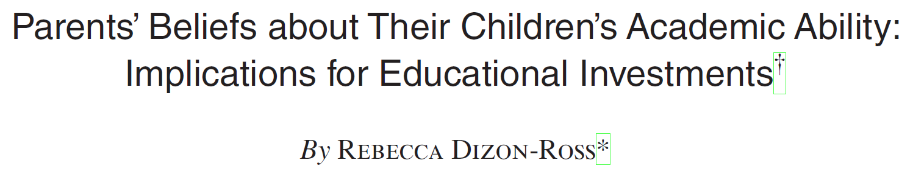{fig-align="center"}

:::{.callout-note title="In a nutshell"}
Rural Malawi in 2012. School is free, but parents still spend money on their children's education. They have to decide on how much to invest based on what they know their children's academic potential. In reality, they have very poor (inaccurate) knowledge of their children's academic performance.
\

**What would happen if you provided parents with more accessible information?** Would they invest more? Differently?
:::

## Research Design

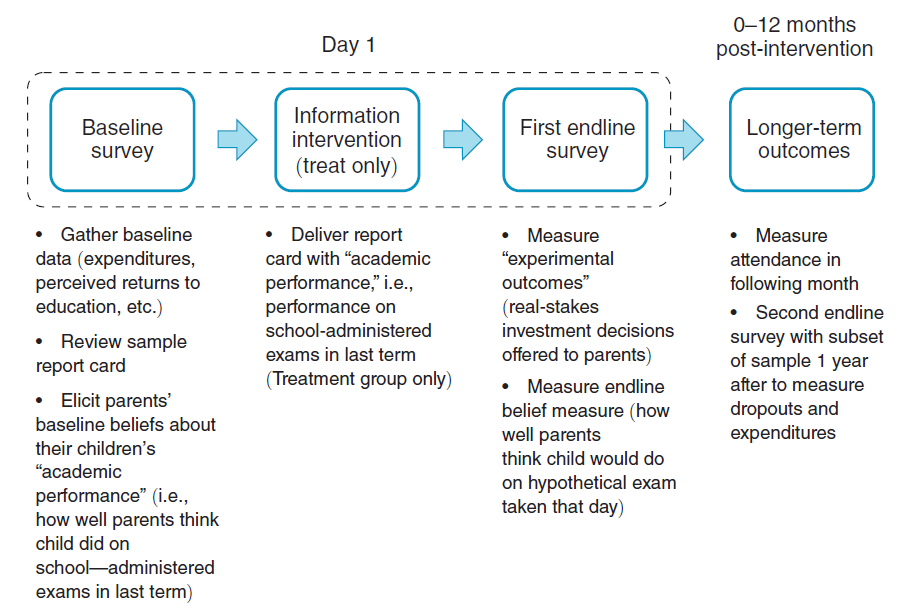{fig-align="center"}

## Balance

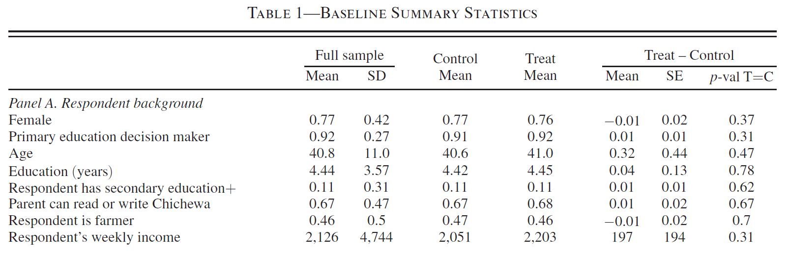{fig-align="center"}

## Simple difference between means

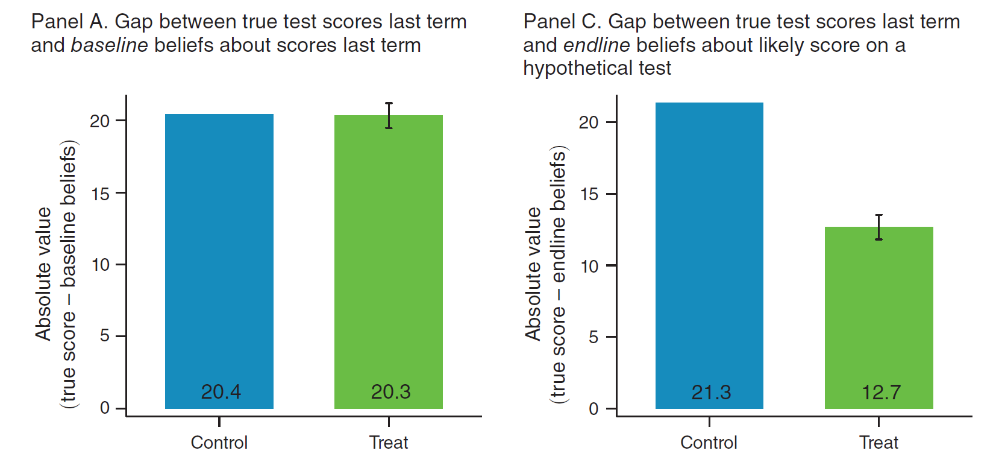{fig-align="center"}

## Heterogeneity

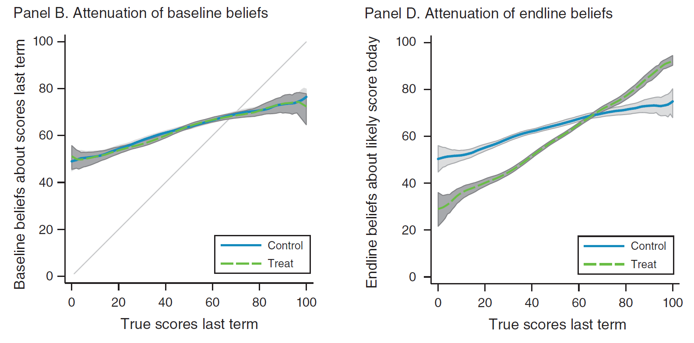{fig-align="center"}

## Regression {.scrollable}

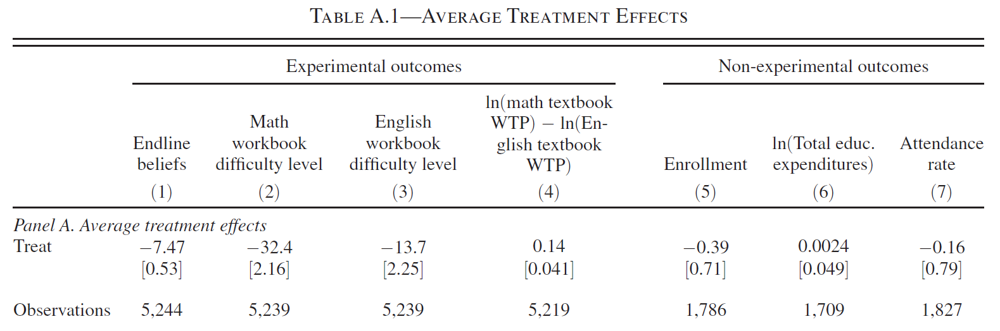{fig-align="center"}
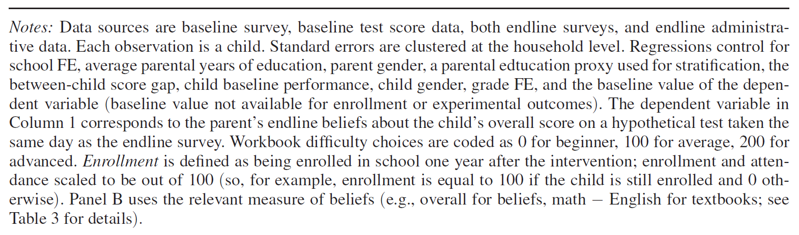{fig-align="center"}

# Potential Outcomes Framework

## Neyman-Rubin Causal Model

The Potential Outcomes Framework is a key component of the Neyman-Rubin Causal Model[^1]

[^1]: Also referred to as the Rubin Causal Model [originally by @holland1986statistics]. The framework is attributed to both Jerzy Neyman and Donald Rubin; as well as Paul Holland [@heckman2022causality]. 

- We won't cover all aspects of this model. 

- I will reference texts in green boxes that you can visit to read further

::::{.content-visible unless-format="revealjs"}
:::{.callout-tip title="On Causation" collapse=true}
The Neyman-Rubin Causal Model is not the only framework for defining causal relationships. In addition, it is a model well suited to the analysis of experimental data. Another causal framework Directed Acyclic Graphs (DAGs) has become very influential in computer and data sciences. See @pearl2018book's now famous book, *They Book of Why*, on the topic. @imbens2020potential provides an excellent discussion of DAG versus POF, and why POF is a more natural fit for economists [see also @heckman2022causality]. 

Finally, there are other notions of causal relations in Econometrics. For example, in time series there is the concept of Granger causation which relates more to temporal prediction and structural modelling thinks about causation outside of the “no causation without manipulation” notion of causation within the Neyman-Rubin model [@rubin1975bayesian, p. 238]. You might enjoy @hoover2008causality's discussion on the topic. 
:::
::::

## Component 1

The Neyman-Rubin model has three important components [@imbens2015causal]
\

> **Potential Outcomes**: The outcomes corresponding to different levels of treatment or manipulation: “no causation without manipulation” [@rubin1975bayesian, p. 238]

- Potential outcomes are *a priori* observable, but *a posteriori* only one outcome is observable. 

- A variable can only be a "cause" if it is possible, at least in principle, to conceive of a hypothetical or physical intervention ("treatment") that manipulates it. We tend not to discuss the causal effect of demographic characteristics.[^2]

[^2]: The caveat here might be hypothetical resume studies; e.g. @bertrand2004emily and @oreopoulos2011skilled.

## Components 2

> **Multiple units**: Given the limit on observation, one must observe multiple units to infer a causal effect.

- Need to make a key stability assumption: Stable Unit Treatment Value Assumption (SUTVA).

::::{.content-visible unless-format="revealjs"}
:::{.callout-tip title="SUTVA" collapse=true}
The Stable Unit Treatment Value Assumption (SUTVA) is an overarching assumption for this entire Neyman-Rubin Causal Model

> “The potential outcomes for any unit do not vary with the treatments assigned to other units, and, for each unit, there are no different forms or versions of each treatment level, which lead to different potential outcomes.” [@imbens2015causal, p. 10]

This assumption,

1. **Rules out interference between treatment units.** This rules out any spillover effects between ‘treatment’ and ‘control’.

2. **Ensures that there are no hidden variations in the treatment level.** It is okay for there to be different levels of treatment, so long as they are explicit and well-defined *a priori*.

:::
::::

## Component 3

> **Assignment mechanism**: The function that determines the manipulation of units. 

Assignment may be:

- **probabilistic**; e.g. randomized experiment 

- **deterministic**; e.g. thresholds/cutoffs

- **conditional**; depend partly depend on observable characteristics ($\mathbf{x}_i$). 

- **controlled** (by the researcher); e.g. randomized control trial

- **exogenous** (to the treatment unit); e.g. public policy or natural experiments[^3]

[^3]: Often referred to as quasi-experiment. 

- **known** (by the researcher); e.g. controlled or natural experiments

- **unknown**; e.g. observational study, 

::::{.content-visible unless-format="revealjs"}
:::{.callout-tip title="Propensity score" collapse=true}
If you continue to study causal inference you learn about methodologies like propensity score matching. The propensity score is the probability of treatment conditional on a set of observable characteristics. 

$$
  \rho(\mathbf{x_i}) = Pr(w_i=1|\mathbf{x}_i)
$$

This measure is key to many causal inference results. You can re-frame the question "do we know the assignment mechanism" to "do we know the functional form of the propensity score". 
:::
::::

## Example

Consider the example of @dizon2019parents: there are two possible *states of the world*:

:::: columns
::: {.column width="50%"}
**Treated**: 

- receive information 

\

Researcher observes:

$$
y(\text{info})
$$

:::
::: {.column width="50%"}

::: {.fragment .fade-in}
**Untreated**: (*control*) 

- no information (status-quo)

\

Researcher observes:
$$
  y(\text{status-quo})
$$

:::

:::
::::

::: {.fragment .fade-in}
We call these **potential outcomes**.
:::

## Possible outcomes

For a discrete outcome like enrollment there are 4 possible outcomes:

::: incremental
1. Enroll only with information

   $$
     y(\text{info})=\textcolor{red}{\text{enroll}} \qquad \text{and}\qquad y(\text{status-quo})=\textcolor{blue}{\text{don't enroll}}
   $$

2. Enroll, regardless

   $$
     y(\text{info})=\textcolor{red}{\text{enroll}} \qquad \text{and}\qquad y(\text{status-quo})=\textcolor{red}{\text{enroll}}
   $$

3. Don't enroll, regardless

   $$
     y(\text{info})=\textcolor{blue}{\text{don't enroll}} \qquad \text{and}\qquad y(\text{status-quo})=\textcolor{blue}{\text{don't enroll}}
   $$

4. Enroll only without information

   $$
     y(\text{info})=\textcolor{blue}{\text{don't enroll}} \qquad \text{and}\qquad y(\text{status-quo})=\textcolor{red}{\text{enroll}}
   $$
:::

## Causal effect

According to the Neyman-Rubin Causal Model, in: 

- scenarios (1) **and** (4) there has been a **causal effect**

- scenarios (2) **and** (3) there has been NO *causal effect*.

:::{.callout-important}
Notice two things [@imbens2015causal, p. 6],

1. "First, the definition of the causal effect depends on the potential outcomes, but it does not depend on which outcome is actually observed."

2 "Second, the causal effect is the comparison of potential outcomes, for the same unit, at the same moment in time post-treatment. In particular, the causal effect is not defined in terms of comparisons of outcomes at different times."
:::

## Notation

Let $w_i \in \{0,1\}$ be an indicator of an individuals *discrete* treatment status.[^4]:

[^4]: This notation of $w_i$ as an indicator of an unit's treatment status is common in the literature on experiments and is used in one of the seminal books on the topic: @imbens2015causal's *Causal Inference in Statistics, Social, and Biomedical Sciences*. You will see it in @wooldridge2025 [sec. 7.6]. 

- $y_i\small{(1)}$ be the potential outcome when treated

- $y_i\small{(0)}$ be the potential outcome when not treated[^5]

[^5]: You will see other notations in the literature. For example, the use of superscripts $\{y_i^1,y_i^0\}$ or subscripts $\{y_{i1},y_{i0}\}$.

::::{.content-visible unless-format="revealjs"}
:::{.callout-tip title="Continuous Treatment" collapse=true}
We focus here on discrete treatments. It is straight forward to incorporate additional, separate treatments, but to model a continuous treatment you need to make additional assumptions about the functional form of the causal model. The only assumption we have made here is that of **additive treatment effects**: $y_i\small{(1)} = y_i\small{(0)}+\tau_i$. 

The model may in fact be multiplicative: $y_i\small{(1)} = y_i\small{(0)}\times\tau_i$. This distinction becomes important when you consider that many researchers use this framework to estimate treatment effects measured in log-transformed outcome variables. 

One solution to the continuous treatment problem is to think about different treatment "dosages" (as in medicine). This approach discretizes the continuous treatment and returns the problem to the simple binary case. 
:::
::::

## Observed outcome

*A priori*, both potential outcomes could be realised, but **in the data you observe only one**:

$$
  y_i = \begin{cases}y_i\small{(1)}\quad \text{if}\; w_i=1 \\
  y_i\small{(0)}\quad \text{if}\; w_i=0
  \end{cases}
$$

> "fundamental problem of causal inference" [@holland1986statistics, p. 947]

::: {.fragment .fade-in}
Which we can write this as a linear function:

$$
  y_i = y_i\small{(0)} + w_i\big(y_i\small{(1)}-y_i\small{(0)}\big)
$$

:::

## ITE

The individual (unit) treatment effect (ITE) is defined as, 

$$
  \tau_i = y_i\small{(1)}-y_i\small{(0)}
$$

\

However, *you cannot observe (identify) or estimate the ITE*

::: {.fragment .fade-in}
**WHY?** 

- it would require you to observe **both** potential outcomes of the same unit *in the same period*

- referred to as the "missing data problem" [@imbens2015causal, p. 34]

:::

::: {.fragment .fade-in}
**Notice!** 

- the individual level treatment effect varies at the individual level: $\tau_i$

:::

## Visualization

*A priori*, both potential outcomes are observable

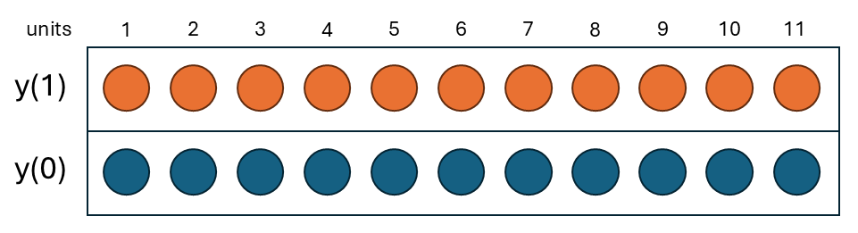{fig-align="center"}

##

Then, treatment is assigned

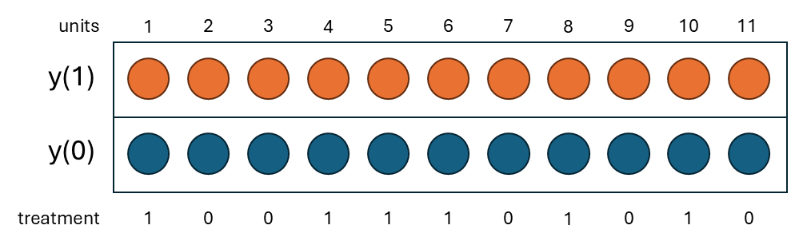{fig-align="center"}

##

Treatment determines which PO you observe

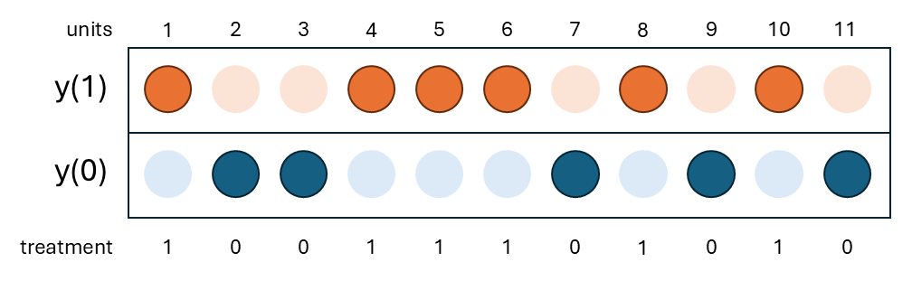{fig-align="center"}

##

There is an observed outcome and (theoretically) a missing one

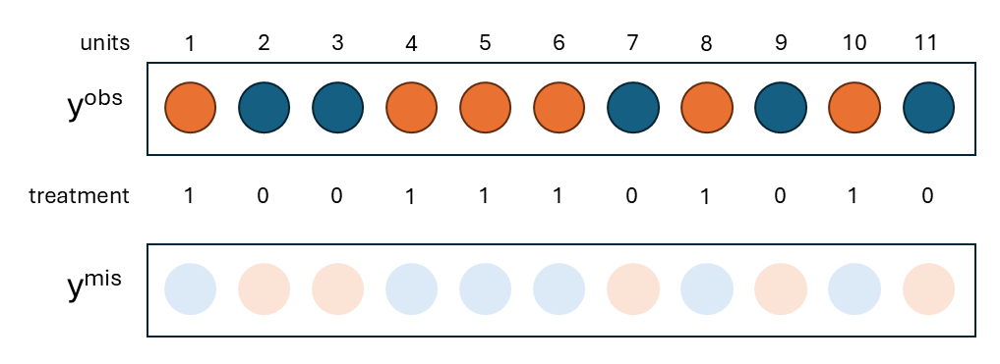{fig-align="center"}

## Average TEs

In place of the ITE, we focus on identifying and estimating average TEs

::: incremental

- Average Treatment Effect (ATE)

  $$
    \tau_{ate} = E[\tau_i] = E\big[y_i\small{(1)}-y_i\small{(0)}\big]
  $$

- Average Treatment Effect of the Treated (ATT)

  $$
    \tau_{att} = E[\tau_i|w_i = 1] = E\big[y_i\small{(1)}-y_i\small{(0)}|w_i=1\big]
  $$

- Average Treatment Effect of the Untreated (ATU)

  $$
    \tau_{atu} = E[\tau_i|w_i = 0] = E\big[y_i\small{(1)}-y_i\small{(0)}|w_i=0\big]
  $$
  
  These are called **causal estimands**

:::

::::{.content-visible unless-format="revealjs"}
:::{.callout-tip title="Finite vs Super Population" collapse=true}
These are all super population casual estimands, denoted in terms of the expected values. There is a corresponding set of finite sample causal estimands in which the realized sample is held constant [see @imbens2015causal]. 

In our discussion of regression models, the primary source of randomness was sampling. The super population definition of causal estimands takes the same approach: the expectation here is with respect to the (unobservable) population distributions. 

However, in this world of randomized experiments there is a second source of randomness: assignment (i.e. $w_i$). In a different realization of the experiment, a different set of individuals *within the same sample* could have been treated. You can therefore think about the ATE of the finite, fixed sample. 

$$
  \tau^{fs}_{ate} = \frac{1}{n}\sum_{i=1}^n\tau_i = \frac{1}{n}\sum_{i=1}^n (y_i\small{(1)}-y_i\small{(0)})
$$

As with the super population ATE, you can observe this in the data. It would require knowing both $y_i\small{(1)}$ and $y_i\small{(0)}$ for every individual. 

This finite sample approach tends not to be used extensively in applied economics research. Economists tend to take the approach of thinking about the fixed sample as a draw from the sampled (super) population and use their estimates to learn about the wider population. You see this in the way economists evaluate public policies. 
:::
::::

## ATE vs ATT

:::: columns
::: {.column width="50%"}
We prefer the **ATE** if,

- we want to learn about the effect on the entire population; 

- i.e., mandatory exposure.

- or lottery

:::
::: {.column width="50%"}
We prefer the **ATT** if,

- the population includes individuals that will not take up the treatment/policy;

- e.g., a policy that targets single mothers;

- or program is voluntary, 
:::
::::

::: {.fragment .fade-in}
The ATT is “informative about the effect of entirely eliminating the current
program” [@imbens2009recent, pp. 14-15].
:::

# Assignment

## Two groups

Suppose you treat one group of individuals, while observing another untreated. Then *in expectation*, you can learn about

$$
  E[y_i|w_i = 1] - E[y_i|w_i = 0]
$$

\

::: {.fragment .fade-in}
Substituting in $y_i = y_i\small{(0)} + w_i\big(y_i\small{(1)}-y_i\small{(0)}\big)$

$$
  E[y_i\small{(1)}|w_i = 1] - E[y_i\small{(0)}|w_i = 0]
$$

:::

## 

Is this equal to either the ATE, ATT, or ATU? **NO!** 
$$
  E[y_i\small{(1)}|\textcolor{red}{w_i = 1}] - E[y_i\small{(0)}|\textcolor{blue}{w_i = 0}]
$$

::: {.fragment .fade-in}
**Why?**

- The conditions are not the same!

:::

## Decomposition

Let us add and subtract:

$$
  \textcolor{red}{E[y_i\small{(0)}|w_i = 1]} 
$$

the **unobserved counterfactual** for the treated group.

\

::: {.fragment .fade-in}

$$
  E[y_i\small{(1)}|w_i = 1] - \textcolor{red}{E[y_i\small{(0)}|w_i = 1]} + \textcolor{red}{E[y_i\small{(0)}|w_i = 1]}- E[y_i\small{(0)}|w_i = 0]
$$

:::

## 

The expression has two parts:

$$
  \begin{aligned}
    &\underbrace{E[y_i\small{(1)}|w_i = 1] - \textcolor{red}{E[y_i\small{(0)}|w_i = 1]}} + \underbrace{\textcolor{red}{E[y_i\small{(0)}|w_i = 1]}- E[y_i\small{(0)}|w_i = 0]} \\
    =& \underbrace{E[y_i\small{(1)}-y_i\small{(0)}|w_i = 1]}_\text{ATT}+ \underbrace{\textcolor{red}{E[y_i\small{(0)}|w_i = 1]}- E[y_i\small{(0)}|w_i = 0]}_\text{selection}
  \end{aligned}
$$

\

:::{.callout-important title="Self-selection"}
As alluded to earlier in [Lecture 3](lecture-3-multi.qmd), selection here is different to the problem of sample selection. This selection problem can more aptly described as the "self-selection problem" [@wooldridge2025, p. 255]. 
:::

## Selection

The problem of selection **into treatment** is fundamental to any discussion of causation. 

$$
  \underbrace{\textcolor{red}{E[y_i\small{(0)}|w_i = 1]}- E[y_i\small{(0)}|w_i = 0]}_\text{selection}
$$

The term describes the difference between 

1. an unobserved counterfactual outcome of the treated group: the outcome mean you *would have* observed, had the group NOT been treated
   
2. the observed outcome mean of the untreated (control) group

## Unconfoundedness

In order to say much more, we need an assumption:

> **Unconfounded assignment:** assignment into the treatment is unconfounded if
>
> $$
>   y_i\small{(1)},y_i\small{(0)} \perp w_i
> $$

\

And, **if assignment is random, then it is unconfounded**. 

:::{.callout-note}
Some people equate unconfoundedness with randomization, but they are distinct. Unconfoundedness is a property of an assignment mechanism: treatment assignment is independent of potential outcomes, possibly conditional on covariates. Randomization is one particular assignment mechanism that guarantees this property by design. In observational studies, by contrast, unconfoundedness can’t be guaranteed and must instead be assumed. 
:::

::::{.content-visible unless-format="revealjs"}
:::{.callout-tip title="Unconfounded vs exogenous" collapse=true}
Unconfoundedness should also be distinguished from exogeneity, a term that is used in several different senses. In applied work it often means simply that a treatment is imposed from outside, as with a government policy change, but external imposition does not ensure that assignment is unrelated to the factors that determine outcomes. In econometrics it more formally means that a regressor is uncorrelated with the error term of a particular model, which is both a weaker condition than independence and one that depends on how the model is specified. Unconfoundedness, by contrast, is defined directly in terms of the assignment mechanism and the potential outcomes: assignment is independent of the potential outcomes given covariates, that is, as if randomly assigned.
:::
::::

## Unconfounded assignment

1. $E[y_i\small{(0)}|w_i=1] = E[y_i\small{(0)}|w_i=0] = E[y_i\small{(0)}]$

   $$
     \Rightarrow \underbrace{\textcolor{red}{E[y_i\small{(0)}|w_i = 1]}- E[y_i\small{(0)}|w_i = 0]}_\text{selection} = 0
   $$

::: {.fragment .fade-in}

2. $\underbrace{E[y_i\small{(1)}-y_i\small{(0)}|w_i = 1]}_\text{ATT}=\underbrace{E[y_i\small{(1)}-y_i\small{(0)}|w_i = 0]}_\text{ATU}=\underbrace{E[y_i\small{(1)}-y_i\small{(0)}}_\text{ATE}$

:::

## 

If assignment is unconfounded, then

$$
  E[y_i|w_i = 1] - E[y_i|w_i = 0] = \tau_{ate}
$$

::: {.fragment .fade-in}
We therefore refer to unconfoundedness as the **identifying assumption**. 

- without it we cannot learn about the ATE (or ATT) from the difference between two groups. 

:::

## Testing unconfoundedness

In practice, researchers attempt to demonstrate that "randomization has worked" through the construction of a **balance table**

- Test difference in *baseline* covariates across treatment-control

- Can do a joint ANOVA test or adjust $p$-values for multiple inference.

- Covariates must be *observable*  (hence, baseline survey)

- Researcher hopes to *fail to reject* $H_0:$ difference. Does not prove unconfounded assignment.

\

:::{.callout-important title="Expectation vs Realization"}
Random assignment gives you unconfoundedness, which **in expectation** means that the treatment and control group are (theoretically) the same. The realized allocation will consist of two groups that are NOT the same. 

We can rely on LLN to say that for a large enough sample, the mean of each group approaches its expected value. But, many RCTs do not have very large samples. 
:::

# Estimation

## Estimator

Under unconfoundedness, the ATE has a simple difference between means (SDM) estimator [@wooldridge2025, sec. 2.7a]

$$
  \hat{\tau} = \bar{y}_1 - \bar{y}_0
$$

where, 

$$
  \bar{y}_1 = \frac{1}{\textcolor{red}{n_1}}\sum_{i:\textcolor{red}{w_i=1}}y_i \qquad \text{and}\qquad \bar{y}_0 =\frac{1}{\textcolor{blue}{n_0}}\sum_{i:\textcolor{blue}{w_i=0}}y_i
$$

and $n_1$ ($n_0$) is number of treated (control) units

## Variance

The variance of this estimator is 

$$
  Var(\hat{\tau}) = \frac{\sigma_0^2}{n_0} + \frac{\sigma_1^2}{n_1}
$$

Which can be estimated by,

$$
  \widehat{Var}(\hat{\tau}) =  \frac{\hat{\sigma}_0^2}{n_0} + \frac{\hat{\sigma}_1^2}{n_1}
$$

where $\hat{\sigma}_j^2 = \frac{1}{n_j-1}\sum_{i: w_i=j} (y_i-\bar{y}_j)^2$ for $j=0,1$.

- We call this the Neyman variance estimator within Causal Inference literature.[^6]

[^6]: Also referred to as the Welch test/estimator.

## Homogeneous vs heterogenous TEs

If TEs are **homogeneous**:

$$
  \tau_i=y_i\small{(1)}-y_i\small{(0)}=\tau \;\forall\; i
$$

Then, 

$$
  y_i = y_i\small{(0)} + w_i(y_i\small{(1)}-y_i\small{(0)}) = y_i\small{(0)} + w_i\tau
$$

And, 

$$
  \sigma_0^2 = \sigma_1^2 = \sigma^2
$$

## Demonstration

Consider the following (simulated) distribution of $y_0$, which need not not be normal. 

```{r}
#| echo: false

k   <- 4     # chi-squared degrees of freedom: mean = k, variance = 2k
x  <- seq(0, 30, length.out = 2000)
d0 <- data.frame(x = x, y = dchisq(x, df = k))
 
mu0  <- k
peak <- max(d0$y)
blue <- "#1f5fbf"
 
ggplot(d0, aes(x, y)) +
  geom_area(fill = blue, alpha = 0.15) +
  geom_line(colour = blue, linewidth = 1.1) +
  # mean
  annotate("segment", x = mu0, xend = mu0, y = 0, yend = peak * 1.08,
           colour = blue, linetype = "dashed", linewidth = 0.6) +
  annotate("text", x = mu0, y = -0.012, label = "mu[0]", parse = TRUE,
           colour = blue, size = 4.5) +
  # curve label
  annotate("text", x = 0.6, y = peak * 1.02, label = "f[0]",
           parse = TRUE, colour = blue, size = 7) +
  scale_y_continuous(expand = expansion(mult = c(0.06, 0.12))) +
  labs(
    x = "Potential Outcome",
    y = "Density",
    title = "Distribution of y(0)"
    #subtitle = bquote(chi[.(k)]^2 ~ "  " ~ mu[0] == .(k) * "," ~ Var[0](Y) == .(2 * k))
  ) +
  theme_minimal(base_size = 13) +
  theme(panel.grid.minor = element_blank(),
        plot.title = element_text(face = "bold"))

```

##

If TEs are homogeneous, then $y_i\small{(1)} = y_i\small{(0)} + \tau$ (i.e. a mean shift)

```{r}
#| echo: false

k   <- 4     # chi-squared degrees of freedom: mean = k, variance = 2k
tau <- 6     # homogeneous treatment effect
 
x  <- seq(0, 30, length.out = 2000)
f0 <- dchisq(x, df = k)
f1 <- dchisq(x - tau, df = k)        # zero for x < tau, as it should be
 
dens <- rbind(
  data.frame(x = x, y = f0, dist = "f0"),
  data.frame(x = x, y = f1, dist = "f1")
)
 
mu0   <- k
mu1   <- k + tau
peak  <- max(f0)
y_arr <- peak * 1.08                 # height of the shift arrow
 
cols <- c(f0 = "#1f5fbf", f1 = "#d1495b")
 
ggplot(dens, aes(x, y, colour = dist, fill = dist)) +
  geom_area(alpha = 0.15, position = "identity", colour = NA) +
  geom_line(linewidth = 1.1) +
  # means
  annotate("segment", x = c(mu0, mu1), xend = c(mu0, mu1), y = 0, yend = y_arr,
           colour = cols, linetype = "dashed", linewidth = 0.6) +
  # shift arrow between the means
  annotate("segment", x = mu0, xend = mu1, y = y_arr, yend = y_arr,
           arrow = arrow(length = unit(0.25, "cm"), type = "closed"),
           linewidth = 0.9) +
  annotate("text", x = (mu0 + mu1) / 2, y = y_arr, vjust = -0.6,
           label = "tau", parse = TRUE, size = 6) +
  # curve labels
  annotate("text", x = 0.6, y = peak * 1.02, label = "f[0]",
           parse = TRUE, colour = cols["f0"], size = 7) +
  annotate("text", x = mu1 + 4.5, y = peak * 0.8, label = "f[1]",
           parse = TRUE, colour = cols["f1"], size = 7) +
  # mean labels on the axis
  annotate("text", x = mu0, y = -0.012, label = "mu[0]", parse = TRUE,
           colour = cols["f0"], size = 4.5) +
  annotate("text", x = mu1, y = -0.012, label = "mu[1] == mu[0] + tau",
           parse = TRUE, colour = cols["f1"], size = 4.5, hjust = 0.2) +
  scale_colour_manual(values = cols, guide = "none") +
  scale_fill_manual(values = cols, guide = "none") +
  scale_y_continuous(expand = expansion(mult = c(0.06, 0.12))) +
  labs(
    x = "Potention outcomes",
    y = "Density",
    title = "Homogeneous treatment effects (example)"
    #subtitle = bquote(
    #  f[1](y) == f[0](y - tau) ~ "  so  " ~
    #  Var[1](Y) == Var[0](Y) ~ "=" ~ .(2 * k) ~ "  (" * chi[.(k)]^2 * "," ~ tau == .(tau) * ")"
    #)
  ) +
  theme_minimal(base_size = 13) +
  theme(panel.grid.minor = element_blank(),
        plot.title = element_text(face = "bold"))

```

The variance does not change. 

## Homogenous TEs

If TEs are **homogenous**

$$
  Var(\hat{\tau}) = \frac{\sigma_0^2}{n_0} + \frac{\sigma_1^2}{n_1} = \sigma^2\bigg(\frac{1}{n_1} + \frac{1}{n_0}\bigg)
$$

Which can be estimated as, 

$$
\hat{\sigma}^2 = \frac{1}{n-2}\big((n_0-1)\times \hat\sigma_0^2 + (n_1-1)\times \hat\sigma_1^2 \big)
$$

We call this the **constant variance estimator**.

## 

If the TEs are heterogeneous, then $y_i\small{(1)} = y_i\small{(0)} + \tau_i$

```{r}
#| echo: false

k   <- 4     # chi-squared degrees of freedom: mean = k, variance = 2k
tau <- 6     # homogeneous treatment effect
 
x  <- seq(0, 30, length.out = 2000)
f0 <- dchisq(x, df = k)
f1 <- dchisq(x - (tau-k), df = 2*k)        # zero for x < tau, as it should be
 
dens <- rbind(
  data.frame(x = x, y = f0, dist = "f0"),
  data.frame(x = x, y = f1, dist = "f1")
)
 
mu0   <- k
mu1   <- k + tau
peak  <- max(f0)
y_arr <- peak * 1.08                 # height of the shift arrow
 
cols <- c(f0 = "#1f5fbf", f1 = "#d1495b")
 
ggplot(dens, aes(x, y, colour = dist, fill = dist)) +
  geom_area(alpha = 0.15, position = "identity", colour = NA) +
  geom_line(linewidth = 1.1) +
  # means
  annotate("segment", x = c(mu0, mu1), xend = c(mu0, mu1), y = 0, yend = y_arr,
           colour = cols, linetype = "dashed", linewidth = 0.6) +
  # shift arrow between the means
  annotate("segment", x = mu0, xend = mu1, y = y_arr, yend = y_arr,
           arrow = arrow(length = unit(0.25, "cm"), type = "closed"),
           linewidth = 0.9) +
  annotate("text", x = (mu0 + mu1) / 2, y = y_arr, vjust = -0.6,
           label = "tau[ate]", parse = TRUE, size = 6) +
  # curve labels
  annotate("text", x = 0.6, y = peak * 1.02, label = "f[0]",
           parse = TRUE, colour = cols["f0"], size = 7) +
  annotate("text", x = mu1 + 4.5, y = peak * 0.8, label = "f[1]",
           parse = TRUE, colour = cols["f1"], size = 7) +
  # mean labels on the axis
  annotate("text", x = mu0, y = -0.012, label = "mu[0]", parse = TRUE,
           colour = cols["f0"], size = 4.5) +
  annotate("text", x = mu1, y = -0.012, label = "mu[1] == mu[0] + tau[ate]",
           parse = TRUE, colour = cols["f1"], size = 4.5, hjust = 0.2) +
  scale_colour_manual(values = cols, guide = "none") +
  scale_fill_manual(values = cols, guide = "none") +
  scale_y_continuous(expand = expansion(mult = c(0.06, 0.12))) +
  labs(
    x = "Potention outcomes",
    y = "Density",
    title = "Heterogeneous treatment effects (example)"
    #subtitle = bquote(
    #  f[1](y) == f[0](y - tau) ~ "  so  " ~
    #  Var[1](Y) == Var[0](Y) ~ "=" ~ .(2 * k) ~ "  (" * chi[.(k)]^2 * "," ~ tau == .(tau) * ")"
    #)
  ) +
  theme_minimal(base_size = 13) +
  theme(panel.grid.minor = element_blank(),
        plot.title = element_text(face = "bold"))

```

## Distribution

Note, we do not know the distribution of $y_i\small{(0)}$ or $y_i\small{(1)}$!

- In applied work, researchers prefer not to make any assumptions

- Rely on CLT to show asymptotic distribution is normal

- In practice, and since RCTs often have a small sample, use $t$-distribution to be more conservative

- There are other approaches to inference (e.g., permutation tests like Fisher's exact $p$-value) that we won't cover here, but are more relevant for small samples. 

## In Stata/R {.scrollable}

Example uses a 10% sample of the replication data for @dizon2019parents.

```{r}
#| echo: false
#| code-fold: true
#| output: false
#| warning: false

# Load the Stata file
dr19_dta <- read_dta(file.path(data_dir, "dizonross2019_small.dta"))
```

Constant variance test

```{r}
#| echo: true
#| code-fold: false
#| warning: false

t.test(belief_err_bl ~ treat, data = dr19_dta, var.equal = TRUE)
```

Unequal variance test (Neyman)

```{r}
#| echo: true
#| code-fold: false
#| warning: false

t.test(belief_err_bl ~ treat, data = dr19_dta, var.equal = FALSE)
```

# Linear Model

## Dummy regressor

We know that for a discrete $x_i\in\{0,1\}$,

$$
  y_i = \beta_0 + \beta_1 x_i + u_i
$$

\

where,
$$
  \beta_1 = E[y_i|x_i=1]-E[y_i|x_i=0]
$$

## OLS

Moreover, we showed in [Lecture 2](lecture-2-multi.qmd) that the OLS estimator for $\beta_1$ is just, 

$$
  \hat{\beta}_1 = \bar{y}_1 - \bar{y}_0
$$

## Translation of POF

We can translate the POF to a linear regression model,[^7]

[^7]: @wooldridge2025 [sec. 2.7a] also includes a version with homogeneous TEs. This is the more general case. 

$$
  \begin{aligned}
    y_i =& y_i\small{(0)} + w_i(y_i\small{(1)}-y_i\small{(0)}) \\
      =& y_i\small{(0)} + \tau_i w_i \\
      =& \textcolor{blue}{E[y_i\small{(0)}]} + \tau_i w_i + y_i\small{(0)}-\textcolor{blue}{E[y_i\small{(0)}]} \\
      =& \textcolor{blue}{E[y_i\small{(0)}]} + \textcolor{red}{\tau_{ate}} w_i + \underbrace{y_i\small{(0)}-\textcolor{blue}{E[y_i\small{(0)}]} + (\tau_i-\textcolor{red}{\tau_{ate}})w_i}_{u_i} \\
      =& \alpha_0 + \textcolor{red}{\tau_{ate}}w_i + u_i
  \end{aligned}
$$

##

Consider the error term:

$$
  u_i = \underbrace{y_i\small{(0)}-\textcolor{blue}{E[y_i\small{(0)}]}}_{1.} + \underbrace{(\tau_i-\textcolor{red}{\tau_{ate}})}_{2.}\underbrace{w_i}_{3.}
$$

it includes, 

1. the deviation of $y_i(0)$ from its unconditional mean

2. the devation of $\tau_i$ from its unconditional mean (i.e. $\tau_{ate}$) $\Leftarrow$ **heterogeneity**

3. $w_i$ is found in the error term, as well

::: {.content-visible unless-format="revealjs"}

## Wooldridge's notation

@wooldridge2025 [sec. 7.2a] defines:

$$
  \begin{aligned}
    u_i\small{(0)} =& y_i\small{(0)}-E[y_i\small{(0)}] \\
    u_i\small{(1)} =& y_i\small{(1)}-E[y_i\small{(1)}] \\
  \end{aligned}  
$$

which then gives you, 

$$
  u_i = u_i\small{(0)} = w_i(u_i\small{(1)}-u_i\small{(0)})
$$

from p. 55. We will not use this notation here. However, it helps you, feel free to use it. 

:::

##

Solve for $E[u_i|w_i=0]$

$$
  \begin{aligned}
  E[u_i|w_i=0] =& E\big[y_i\small{(0)}-\textcolor{blue}{E[y_i\small{(0)}]} + (\tau_i-\textcolor{red}{\tau_{ate}})w_i\big|w_i=0\big] \\
  =&E\big[y_i\small{(0)}-\textcolor{blue}{E[y_i\small{(0)}]}\big|w_i=0\big] \\
  =& E[y_i\small{(0)}|w_i=0]-\textcolor{blue}{E[y_i\small{(0)}]} \\
  \end{aligned}
$$

\

::: {.fragment .fade-in}
*If assignment is unconfounded*:

$$
  E[y_i\small{(0)}|w_i=0]-\textcolor{blue}{E[y_i\small{(0)}]} = E[y_i\small{(0)}]-\textcolor{blue}{E[y_i\small{(0)}]} = 0
$$

:::

##

Solve for $E[u_i|w_i=1]$

$$
  \begin{aligned}
    E[u_i|w_i=1] =& E\big[y_i\small{(0)}-\textcolor{blue}{E[y_i\small{(0)}]} + (\tau_i-\textcolor{red}{\tau_{ate}})w_i\big|w_i=1\big] \\
    =& E\big[y_i\small{(0)}-\textcolor{blue}{E[y_i\small{(0)}]} + y_i\small{(1)}-y_i\small{(0)}-\textcolor{red}{E[y_i\small{(1)}]}+\textcolor{red}{E[y_i\small{(0)}]}\big|w_i=1\big] \\
    =& E\big[y_i\small{(1)}-\textcolor{red}{E[y_i\small{(1)}]}\big|w_i=1\big] \\
    =& E[y_i\small{(1)}|w_i=1] -\textcolor{red}{E[y_i\small{(1)}]}
  \end{aligned}
$$

\

::: {.fragment .fade-in}   
Again, *if assignment is unconfounded*:

$$
  E[y_i\small{(1)}|w_i=1] -\textcolor{red}{E[y_i\small{(1)}]} = E[y_i\small{(1)}]-\textcolor{red}{E[y_i\small{(1)}]} = 0
$$

:::

##

Thus, with unconfounded assignment we can write, 

$$
  y_i = \alpha_0 + \tau_{ate}w_i + u_i
$$

where, 

- slope parameter on $w_i$ identifies the ATE
- the error term fulfills MLR 4
- OLS estimator is unbiased (for the ATE)

:::: {.content-visible unless-format="revealjs"}
:::{.callout-warning}
If given the model $y_i = \beta_0 + \beta_1 x_i + u_i$ with $x_i = \{0,1\}$, then it is trivial to say that $E[u_i|x_i]=0$. This is because we can write the CEF of $y$ given $x$ as a linear function:

$$
  E[y_i|x_i] = \underbrace{E[y_i|x_i=0]}_{\beta_0} + \underbrace{\big(E[y_i|x_i=1]-E[y_i|x_i=0]\big)}_{\beta_1}x_i
$$  

All this means is that we can identify the mean of two groups. It does NOT mean that $\beta_1 = E[y_i|x_i=1]-E[y_i|x_i=0]$ is equal to the ATE. **For that, you need unconfoundedness.**

Consider the case where $x_i = \mathbf{1}\{\text{``female''}\}$. Then $\beta_1$ tells you the mean difference between female and male observations. Would you describe this as the ATE of being female? 
:::
::::

## Error variance

We have shown that under unconfoundedness $E[u_i |w_i]=0$.[^8] What about: 

[^8]:  Where $u_i = y_i - \alpha_0 - \tau_{ate}w_i$.

$$
  Var(u_i|w_i)=E[u_i^2|w_i]=?
$$

::: {.fragment .fade-in}

- Suppose TEs are **homogenous**: $\tau_i = \tau = \tau_{ate}\;\forall\;i$

  $$
    u_i = y_i\small{(0)}-\textcolor{blue}{E[y_i\small{(0)}]} + \underbrace{(\tau_i-\textcolor{red}{\tau_{ate}})}_{=0}w_i = y_i\small{(0)}-\textcolor{blue}{E[y_i\small{(0)}]}
  $$

:::

## Homoskedasticity

If treatment effects are **homogeneous**, then 

$$
  E[u_i^2|w_i] = E[(y_i\small{(0)}-\textcolor{blue}{E[y_i\small{(0)}]})^2|w_i] = E[(y_i\small{(0)}-\textcolor{blue}{E[y_i\small{(0)}]})^2] = \sigma^2_0 = \sigma^2
$$  

*under unconfoundedness*. 

- homogeneity $\Rightarrow$ homoskedastic error variance 

## Heteroskedasticity

If TEs are **heterogenous**: 

$$
  E[u_i^2|w_i] = \begin{cases}
  E[(y_i\small{(0)}-\textcolor{blue}{E[y_i\small{(0)}]})^2] = \sigma^2_0 \quad \text{if}\;w_i=0 \\
  E[(y_i\small{(1)}-\textcolor{red}{E[y_i\small{(1)}]})^2] = \sigma^2_1 \quad \text{if}\;w_i=1 \\
  \end{cases}
$$  

*under unconfoundedness*. 

- heterogeneity $\Rightarrow$ heteroskedastic error variance 

::::{.content-visible unless-format="revealjs"}
:::{.callout-tip title="Deaton's critique" collapse=true}
Angus Deaton - a noble laureate in economics - is famous for not being overly enthusiastic about the use of RCTs in Economics; in particular, in Development Econonomics [see @athey2017econometrics]. His critiques of the field range from the ethics of RCTs in poor countries, questions about the real-world policy relevance of RCT-based causal estimates, and more technical points [@deaton2010instruments, @deaton2018understanding, @imbens2018understanding]. 

> "“I argue that evidence from randomized experiments has no special priority. ... Randomized experiments cannot automatically trump other evidence, they do not occupy any special place in some hierarchy of evidence" [@deaton2010instruments, p. 426]

One technical point Deaton emphasized - especially early on - was the apparent lack of attention/care shown to the correct estimation of SEs in RCT-based research.

> "If the regression ... is run with the standard heteroskedasticity correction to the standard error, the result will be the same as the formula for the standard error of the difference between two means, but not otherwise except in the special case where there are equal numbers of experimental and controls, in which case it turns out that the correction makes no difference and the OLS standard error is correct. It is not clear in the experimental development literature whether the correction is routinely done in practice..." [@deaton2010instruments, p. 442]

It is fair to say that the research on best practice has come a long way since then and there is a vaste literature topics like SE estimation for randomized experiments [@athey2017econometrics]. Moreover, the debate over the significance of RCTs in Economics has largely been won, and not by Deaton. In 2019 Esther Duflo, Abhijit Banerjee, and Michael Kremer won the Nobel Prize in Economics "for their experimental approach to alleviating global poverty". The use of RCTs to answer important empirical questions about how the lives of the poor has fundamentally shaped how we design and evaluate real world policies [see @duflo2011poor]. 

:::
::::

## Variance estimator

We know from [Lecture 3](lecture-3-multi.qmd) that the (conditional) variance of the OLS estimator for $\tau_{ate}$ is, 

$$
  \widehat{Var}(\hat{\tau}_{ols}|W) = \frac{\hat{\sigma}^2_{ols}}{SST_w}
$$

**under MLR 5** ($\Leftarrow$ homogeneous TEs). Where, 

$$
  \hat{\sigma}^2_{ols} = \frac{1}{n-2}\sum_{i=1}^n \hat{u}_i^2 
$$

::: {.fragment .fade-in}
This is mathematically equivalent to the constant variance estimator. 

$$
= \frac{1}{n-2}\big((n_0-1)\times\hat\sigma_0^2 + (n_1-1)\times\hat\sigma_1^2\big)
$$

:::

::::{.content-visible unless-format="revealjs"}
:::{.callout-note title="Proof"}
The proof follows a simple trick of splitting the sample into two groups: (1) $w_i = 0$ and (2) $w_i = 1$.

$$
  \begin{aligned}
  \sum_{i=1}^n \hat{u}_i^2  =& \sum_{i=1}^n(y_i-\hat{\alpha}_0-\hat{\tau}_{ols}w_i)^2 \\
  =& \sum_{i:w_i=0}(y_i-\hat{\alpha}_0-\hat{\tau}_{ols}w_i)^2 + \sum_{i:w_i=1}(y_i-\hat{\alpha}_0-\hat{\tau}_{ols}w_i)^2 \\
  =& \sum_{i:w_i=0}(y_i-\hat{\alpha}_0)^2 + \sum_{i:w_i=1}(y_i-\hat{\alpha}_0-\hat{\tau}_{ols})^2
  \end{aligned}
$$

Since $\hat{\alpha}_0 = \bar{y}_0$ and $\hat{\alpha}_0 + \hat{\tau}_{ols}= \bar{y}_1$, the above is just

$$
  \begin{aligned}
  & \sum_{i:w_i=1}(y_i-\bar{y}_0)^2 + \sum_{i:w_i=0}(y_i-\bar{y}_1)^2 \\
  =& (n_0-1)\times\hat\sigma_0^2 + (n_1-1)\times\hat\sigma_1^2
  \end{aligned}
$$

:::
::::

##

In the denominator is

$$
  SST_w = n\bar{w}(1-\bar{w})
$$

:::{.fragment .fade-in}
This formula is quadratic in $\bar{w}$ - the share of the sample treated. 

- At $\bar{w}=0.5$, $SST_w$ is maximized and $Var(\hat{\tau}^{OLS}|W)$ is minimized (holding other factors fixed). 

- A balanced treatment is good for statistical power, as is a larger sample size. 

:::

::::{.content-visible unless-format="revealjs"}
:::{.callout-note title="Proof"}
This proof follows the same simple trick of splitting the sample into two groups: (1) $w_i = 0$ and (2) $w_i = 1$.

$$
  \begin{aligned}
  SST_w =& \sum_{i=1}^n(w_i-\bar{w})^2 \\
  =& \sum_{i:w_i=0}(0-\bar{w})^2 + \sum_{i:w_i=1}(1-\bar{w})^2 \\
  =& n_0 \bar{w}^2 + n_1(1-\bar{w})^2 \\
  =& \underbrace{n(1-\bar{w})}_{=n_0}\bar{w}^2 + \underbrace{n\bar{w}}_{=n_1}(1-\bar{w})^2 \\
  =& n\bar{w}(1-\bar{w})(\bar{w}+1-\bar{w}) \\
  =& n\bar{w}(1-\bar{w}) 
  \end{aligned}
$$

The proof exploits the fact that $\bar{w}$ is just the share of the sample that is treated: $n_1/n$. Likewise, $1-\bar{w} = n_0/n$, the share of the sample untreated.
:::
::::

## 

What if MLR 5 ($\Leftarrow$ heterogeneous TEs) does not hold? 

- The White (1980) heteroskedastic-consistent estimator from [Lecture 5](lecture-5-multi.qmd) was,

$$
  HC0 = \frac{\sum_{i=1}^{n}(w_{i}-\bar{w})^2\hat{u}_i^2}{\text{SST}_w^2}
$$

::: {.fragment .fade-in}
It can be shown (we will not) that, 

$$
  HC0 \neq  \frac{\hat{\sigma}_0^2}{n_0} + \frac{\hat{\sigma}_1^2}{n_1} = HC2
$$

The Neyman estimator is numerically equivalent to HC2. 

- in practice, all HC0-HC3 estimators are asymptotically consistent. 
- HC3 is recommended for smaller samples.

:::

::::{.content-visible unless-format="revealjs"}
:::{.callout-tip title="Proof" collapse=true}
You can use the same trick of splitting the summation to show, 

$$
  \begin{aligned}
    \widehat{Var}(\hat{\tau}_{ols}|W) =& \frac{\sum_{i=1}^{n}(w_{i}-\bar{w})^2\hat{u}_i^2}{\text{SST}_w^2} \\
    =& \frac{\sum_{i:w_i=1}^{n}(1-\bar{w})^2(y_i-\hat{\alpha}_{ols}-\hat{\tau}_{ols})^2+\sum_{i:w_i=0}^{n}(-\bar{w})^2(y_i-\hat{\alpha}_{ols})^2}{\text{SST}_w^2} \\
    =& \frac{(1-\bar{w})^2\sum_{i:w_i=1}^{n}(y_i-\hat{\alpha}_{ols}-\hat{\tau}_{ols})^2+\bar{w}^2\sum_{i:w_i=0}^{n}(y_i-\hat{\alpha}_{ols})^2}{\text{SST}_w^2} \\
    =& \frac{(1-\bar{w})^2(n_1-1)\hat\sigma_1^2+\bar{w}^2(n_0-1)\hat\sigma_0^2}{(n\bar{w}(1-\bar{w}))^2} \\
    =& \frac{n_1-1}{n_1^2}\hat\sigma_1^2+\frac{n_0-1}{n_0^2}\hat\sigma_0^2
  \end{aligned}
$$

And HC1 (Stata's robust default) will be, 

$$
  \frac{n}{n-2}\times \Bigg[\frac{n_1-1}{n_1^2}\hat\sigma_1^2+\frac{n_0-1}{n_0^2}\hat\sigma_0^2\Bigg]
$$

It is evident that for $n$ large, these estimators will be very similar to Neyman's estimator. You can show that HC2 is algebraically equivalent to Neyman (also referred to as Welch test/estimator).  
:::
::::

# Regression Adjustment

## Purpose

The variance of the estimator is (assuming homogeneous TEs), 

$$
  Var(\hat{\tau}_{ols}|W) = \frac{Var(u_i|w_i)}{SST_w} = \frac{\sigma^2_u}{SST_w}
$$

where $u_i$ is from the model, 

$$
  y_i = \alpha_0 + \tau_{ate}w_i + u_i
$$

- The only variation in $y$ explained by this model is the difference between treatment-control.
- Will result in high variance and low-powered test. 

## Covariates

Suppose,

$$
u_i = \gamma x_i + v_i
$$

where $x$ is a regressor measured before assignment[^9]

[^9]: We can extend the notation to include multiple regressors, but it makes some of the math a little difficult. The conclusion does not change. 

- likely explain part of the outcome (i.e. $\gamma\neq 0$)

- commonly referred to as baseline covariates in RCTs

## Regression adjustment

Instead of the simple regression, we estimate

$$
  y_i = \alpha_0 + \tau_{ate}w_i + \gamma x_i + v_i
$$

- @wooldridge2025 [p. 257] refers to this as the Restricted Regression Adjustment (RRA) 

## Variance

From [Lecture 3](lecture-3-multi.qmd) we know,

$$
  Var(\hat{\tau}_{rra}|W,X) = \frac{Var(v_i|w_i,x_i)}{SSR_w} =  \frac{\sigma^2_v}{SSR_w}
$$

where, 

$$
  SSR_w=SST_w (1-R_w^2)
$$

::: {.fragment .fade-in}

- $R^2_w$ is the amount of variance in assignment explained by the covariates. **This should be low, but won't be zero.**

- While $R^2_w\neq 0$ in the finite sample, $R^2_w\rightarrow 0$ as $n\rightarrow \infty$

- So, $SSR_w\approx SST_w$. 

:::

## Error variance

The improvement in power comes from the fact that, 

$$
   \underbrace{Var(u_i|w_i)}_{\sigma^2_u} = Var(\gamma x_i + v_i|w_i) = \underbrace{\gamma^2 Var(x_i)}_{>0} + \underbrace{Var(v_i|w_i,x_i)}_{\sigma^2_v} 
$$

assuming 

- $Cov(x_i,v_i|w_i)=0$

- $w_i$ is assigned independently of $x_i$: $Var(x_i|w_i) = Var(x_i)$

- $Var(v_i|w_i)=Var(v_i|w_i,x_i)$ ($\Leftarrow$ heterogeneity unrelated to $x$)

## Power

Putting these two together, 

$$
 Avar(\hat{\tau}_{rra}) \leq Avar(\hat{\tau}_{ols})
$$

where $Avar()$ is the asymptotic variance.[^10]

[^10]: This is a place holder for $p\lim \hat\sigma^2/(n^{-1}SSR_w)$.

:::{.fragment .fade-in}
Adding covariates, 

- Reduces variance of the estimator by reducing the error variance

- Little trade-off in terms of the correlation between $w$ and $x$ (i.e., $R^2_w$) under assignment that is unconfounded (w.r.t. $x$'s). 

  - Any finite sample correlation disappears as $n\rightarrow \infty$.

  - **Covariates must not be potential outcomes of the experiment** (i.e. baseline).

:::

::: {.content-visible unless-format="revealjs"}

## Heterogeneity

This simple story is somewhat complicated by heterogeneity:

- heterogeneity is sits in the error term

- heterogeneity is likely related to $x$

- heterogeneity (that depends on $x$) introduces small-sample bias in models of the form:
  
  $$
    y_i = \alpha_0 + \tau_{ate}w_i + \gamma x_i + v_i
  $$
  
- OLS remains consistent (for the ATE), despite this small-sample bias [@freedman2008regression]

## URA

To avoid this small-sample bias, you can do Unrestricted Regression Adjustment (URA) [@wooldridge2025, p. 257, 259; @negi2021revisiting].

  $$
    y_i = \alpha_0 + \tau_{ate}w_i + \gamma x_i + \eta w_i\times (x_i-\bar{x}) + \varepsilon_i
  $$
  
- includes an interaction between the treatment indicator and the covariate(s)

  - models the heterogeneity related $x$

- the interactions include demeaned covariate(s) 

  - this changes the interpretation of $\eta$ [see @wooldridge2025, sec. 6.2d]
  
  - ensures that the coefficient on $w$ remains the ATE

:::

# Example: Reivisiting Dizon-Ross (2019)

## RCT

:::: columns
::: {.column width="50%"}
Why randomize?

- Resolves the problem of self-selection

- Information parents have is endogenous 

- Randomizing who gets information resolves this (in expectation)

:::
::: {.column width="50%"}
{fig-align="center" width=80%}

:::
::::

## Research Design

:::: columns
::: {.column width="50%"}
Baseline survey:

- Measure covariates: balance and power

Endline survey:

- Measure outcomes

- Need to think about attrition

:::
::: {.column width="50%"}
{fig-align="center" width=80%}
:::
::::

## Balance

:::: columns
::: {.column width="50%"}
Balance:

- Test on observables

- Doesn't consider unobservables

- Will be non-zero correlation in data

- Validates research design

:::
::: {.column width="50%"}
{fig-align="center" width=80%}
:::
::::

## Simple difference between means

:::: columns
::: {.column width="50%"}
SDM:

- Measures ATE under unconfoundedness

- Might have a high variance

:::
::: {.column width="50%"}
{fig-align="center" width=80%}
:::
::::

## Heterogeneity

:::: columns
::: {.column width="50%"}
Heterogeneity:

- POF developed to understand heterogeneous TEs

- Researchers will often commit to important margins of heterogeneity in their pre-analysis. 

:::
::: {.column width="50%"}
{fig-align="center" width=80%}
:::
::::

## Regression

:::: columns
::: {.column width="50%"}
Regression adjustment:

- Can correct for any imbalance

- More valuable as a source of improved power

- Covariates from baseline (i.e. not outcomes of experiment)

:::
::: {.column width="50%"}
{fig-align="center" width=80%}
:::
::::

# References

## Bibliography {.scrollable}
