---
# GENERATED BY _prerender.py FROM lecture-9-multi.qmd - DO NOT EDIT
title: Multi-Period Models and Difference in Differences
subtitle: "Lecture 9 (R code)"
format:
  pdf:
    toc: true
    output-file: lecture-9-notes-R.pdf
engine: knitr
multi-lang: r
lang-r: true
---
  
```{r}
#| include: false
#| cache: false

library(Statamarkdown)
knitr::opts_chunk$set(collectcode = TRUE)
```

```{r}
#| include: false

# Packages
library(haven)    
library(ggplot2)
library(DT)
library(modelsummary)

source(here::here("config.R"))
```

```{stata}
*| include: false

do "config.do"
```

# Data Structure & Notation

## Notation

When we write down a linear regression model for a either a repeated cross section or panel dataset, we add both $i$ and $t$ to the subscripts:

$$
  y_{it} = \beta_0 + \beta_1 x_{it1} + \beta_2 x_{it2} + \dots + \beta_k x_{itk} + u_{it}
$$

::: {.fragment .fade-in}
However, you may also have some variables that

- do not vary with time: $x_{i}$
  
  - e.g. individual ethnicity

- vary only with time: $x_{t}$

  - e.g. adding aggregate unemployment rate to individual level model of wages 
:::

# Pooled Cross Sections

## Hypothetical example: Poverty & SCP

Suppose, a researcher wants to evaluate the impact that of the [Home Energy Scotland Grant and Loan](https://www.homeenergyscotland.org/home-energy-scotland-grant-loan) programme on a household's energy expenditure. 

- Grant of up to £7,500 to install clean heating systems and energy efficiency measures.

{fig-align="center"}

## Empirical specification

They propose the following linear regression model specification

$$
  energy_{it} = \delta + \beta grant_{it} + \mathbf{x}_{it}\gamma + \varepsilon_{it}
$$

To be estimated using repeated cross sections of the Scottish Household Survey.

- $energy_{it}$: amount (£'s) spent on energy

- $grant_{it}$: cumulative amount received from the programme

## Controls

As controls, the author collects information at the household level ($\mathbf{x}_{it}$) on:

1. dwelling type

2. ownership type

3. household size

4. household income

5. number of rooms

6. location

## Time-varying factors

But there are other key macroeconomics variables that explain expenditure on energy over time:

1. Global oil price 

2. Global gas price

2. Domestic energy prices (gas,electricity)

   - Determined by domestic auctions: marginal supplier

This variables vary with time, but NOT across households:

$$
  \mathbf{z}_t\eta
$$

## 

So, our model is actually,

$$
  energy_{it} = \delta + \beta grant_{it} + \mathbf{x}_{it}\gamma + \mathbf{z}_t\eta + \varepsilon_{it}
$$

where, 

- $\mathbf{x}$ includes household level controls

- $\mathbf{z}$ includes time-varying (macroeconomic/aggregate) controls 

## Identification

Since the data comprises repeated cross sections of individual, it is reasonable to assume that each observation is a random draw from the underlying population (MLR 2).

\

- As before, we need MLR1-4a for consistency. 

- The question is more whether MLR 1 holds true across time. 

  - Is the model time-invariant?

## Time-varying parameters

We could evaluate this question using a Chow test:

- Estimate the model separately for each year:

$$
  energy_{it} = \delta_t + \beta_t grant_{it} + \mathbf{x}_{it}\gamma_t + \mathbf{z}_t\eta_t + \varepsilon_{it} \quad \text{for}\;t = 1,\dots,T
$$

- Test whether the parameters vary using $SSR_t$ from each equation. 

## 

**BUT** there is a problem with $\mathbf{z}_t\eta_t$ in this model: 

::: incremental

- In any given period, these variables do not vary

  - e.g., oil price is \$100 in period $t=1$ and \$120 for period $t=2$

  - but within a given period $t$, the oil price doesn't vary across households

- So, $\mathbf{z}_t\eta_t$ is a constant in each individual cross section

  - cannot be separately identified from $\delta_t$, the time-varying constant

:::

## Time fixed effects

If we take our original model and allow the constant term (only) to vary with time.

$$
  energy_{it} = \delta_t + \beta grant_{it} + \mathbf{x}_{it}\gamma + \varepsilon_{it}
$$

then we must exclude all variables that also vary *only* with time: $\mathbf{z}_t\eta$

::: incremental

- We call $\delta_t$ **time fixed effects**

- These time FEs "absorb" any other variables that vary only with time. 

- We say, time FEs "control" for any time-varying (e.g., macroeconomic) factors/shocks; **even ones we don't observe** in the data. 

:::

## Time dummies:

When it comes to estimation, time FEs are equvilent to including a set of dummy variables: one for each year. 

$$
  \delta_t = \sum_{j=1}^{T}\delta_j \mathbf{1}\{j=t\} 
$$

In place of a constant, we have $T$ dummy variables that identify each period. 

- For any given $t$, only one of these dummies $=1$

:::{.callout-note}
This notation can be very confusing. Do not concern yourself with the complicated sum, but rather the intuition that when we include an intercept in a linear regression it gives us the slope coefficient on a constant (a regressor that $=1$ for all observations). To implement time FEs, we are essentially adding a separate constant for each period time. And these constants are all just dummy variables: $\mathbf{1}\{j=t\}$. 
:::

# Panel Models

## Preamble

There is a large, fairly complex literature on panel data models:

- Static vs Dynamic models

- Short (small $T$) vs long (large $T$) panels

- Variance (standard error) corrections for autocorrelation

We are going to skip over many of these topics, to talk about the types of panel data models you might see in modern applied (microeconomic) research

- short, static panel data models

## Identification

As with cross sectional models, the primary concern is the potential endogeneity of the regressors:

$$
  Cov(\varepsilon_{it},x_{itj}) \quad j=1,\dots,k 
$$

## Composite error

What's different in panel data is the opportunity to consider a composite error:

$$
  \varepsilon_{it}= \nu_{i}+\upsilon_{it}
$$

where,

- $\nu_{i}$: time-invariant heterogeneity

  - e.g., unobserved household preferences for heating of the home.

- $\upsilon_{it}$: time-varying unobserved heterogeneity ("shocks")

  - e.g., a household is away and turns off their heating for a month

##

It is likely that time-invariant heterogeneity ($\nu_{i}$) is related to many observed regressors. For example, 

$$
  Cov(\nu_{i}, grant_{it}) \neq 0
$$

- households with a strong environmental preferences are more likely to apply for a grant to investment in solar panels. 

  - This would be a problem of "selection on unobservables"
  
::: {.fragment .fade-in}

**Fortunatley**, we are going to investigate an estimation procedure that eliminates $\nu_i$ from the equation. So, we only need to concern ourselves with MLR 4a w.r.t. $\upsilon_{it}$.

$$
  Cov(\upsilon_{it}, x_{itj}) = 0 \quad j=1,\dots,k
$$

:::

## Autocorrelation

A secondary concern relates to the correlation of $\varepsilon_{it}$ across observations in panel data. 

::: incremental

- Suppose we remove $\nu_{i}$ from the model

- We must expect that 

  $$
    Cov(\upsilon_{it},\upsilon_{is}) \neq 0 \quad \text{for}\; t\neq s
  $$
  
  - Issue for estimation of variance. 
  - We fix this by estimating clustered SEs (at the unit level)

:::

## Example

Consider our model:

$$
  energy_{it} = \delta_t + \beta grant_{it} + \mathbf{x}_{it}\gamma + \varepsilon_{it}
$$

Some of the household characteristics in $\mathbf{x}_{it}$ may not vary with time:

1. dwelling type (might not)

2. ownership type (might not)

3. household size (might not)

4. household income (probably does)

5. number of rooms (might not)

6. location (might not)

**What really matters is whether they vary in the data.**

## Time-invarianct covariates

Let's split up the household characteristics into

- those that vary with time: $\mathbf{x}_{it}\gamma_1$

- those that are time-invariant: $\mathbf{x}_{i}\gamma_2$

$$
  energy_{it} = \delta_t + \beta grant_{it} + \mathbf{x}_{it}\gamma_1 + \mathbf{x}_{i}\gamma_2 + \varepsilon_{it}
$$

## Unit FEs

Because we observe repeated observations of the **same** household, we can include unit FEs

$$
  energy_{it} = \alpha_i + \delta_t + \beta grant_{it} + \mathbf{x}_{it}\gamma_1 + \varepsilon_{it}
$$

::: {.fragment .fade-in}

**BUT** by the same logic as before, 

- unit FEs "absorb" anything that is invariant at the unit level: $\mathbf{x}_{i}\gamma_2$

- we say, unit FEs "control" for any time-invariant (e.g., fixed building characteristics) heterogeneity (i.e. things that vary across $i$); **even ones we don't observe** in the data. 

  - unit FEs potentially control for things we do not observe: e.g. household preferences over how warm to keep their home. 
  
:::

## Time-varying treatment

Crucially, this means that the treatment variable $grant_{it}$ must vary at the **unit-level over time**. 

$$
  energy_{it} = \alpha_i + \delta_t + \beta grant_{it} + \mathbf{x}_{it}\gamma_1 + \varepsilon_{it}
$$

for example, a households (cumulative) grant is looks like over 4 periods

$$
  grant_{i} = \{0,0,3000,7500\}
$$

## Estimation

The OLS estimator for this model is often referred to as the "fixed-effects" (or "within") estimator. The logic is that you estimate a transformed version of the model:

$$
  \widetilde{energy}_{it} = \delta_t + \beta \widetilde{grant}_{it} + \widetilde{\mathbf{x}}_{it}\gamma_1 + \tilde{\upsilon}_{it}
$$

where each variable has been demeaned at the **unit-level**

$$
  \widetilde{energy}_{it} = energy_{it} - \overline{energy}_{i}
$$

  - Remember: when you include a constant in the model it does the same thing, but using the global mean of the variable. 
  
  - Helps with the intuition of why the remaining variables must vary at the unit level over time. 
  
  - The error term is $\tilde{\upsilon}_{it}$ because $\varepsilon_{it} = \nu_{i}+\upsilon_{it}$ and $\nu_{i}$ is time-invariant:
  
  $$
    \tilde{\varepsilon}_{it} = \tilde{\upsilon}_{it}
  $$

# Data Example: EVs & PM2.5

## Data

Unfortunately, we do not have data on these hypothetical grants. 

- Data on EV vehicle registration and neighbourhood PM2.5 from [Lecture 4](lecture-4-multi.qmd)

$$
  \ln(PM2.5_{\ell,t}) = \delta_t + \beta EVshare_{\ell,t} + \gamma \ln(pop_{\ell,t}) + u_{\ell,t}
$$

```{stata}
*| echo: false
*| code-fold: false
*| output: true

* Open data
use "$data_dir\pm25_panel.dta", clear
tab year
```

## Pooled cross section {.scrollable}

```{r}
#| echo: true
#| code-fold: true
#| warning: false
    

# Load the Stata file
pm25_panel <- read.csv(file.path(data_dir, "pm25_panel.csv"))

# Estimate univariate linear regression
model1 <- lm(ln_pm25 ~ ev_share, data = pm25_panel)
model2 <- lm(ln_pm25 ~ ev_share + ln_pop, data = pm25_panel)
model3 <- lm(ln_pm25 ~ ev_share + ln_pop + factor(year), data = pm25_panel)

# View results
modelsummary(list("(1)" = model1, "(2)" = model2, "(3)" = model3))
```

## Panel {.scrollable}

```{stata}
*| echo: true
*| code-fold: true
*| output: true

est clear
qui reg ln_pm25 ev_share 
	est store model1
qui reg ln_pm25 ev_share ln_pop
	est store model2
qui reg ln_pm25 ev_share ln_pop i.year
	est store model3
qui areg ln_pm25 ev_share ln_pop i.year, absorb(la_id)
	est store model4
etable, est(model1 model2 model3 model4)

```

## Unit FEs {.scrollable}

Modern FEs function `reghdfe`
```{r}
#| echo: true
#| code-fold: true
#| warning: false
    

# Load the fixest package
library("fixest")

# Estimate model with two-way FEs
model4 <- feols(ln_pm25 ~ ev_share + ln_pop | la_id + year, data = pm25_panel)

# View results
summary(model4)
```

# Difference in Differences

## 2 groups

In experiments ([lecture 6](lecture-6-multi.qmd)), we compare two groups

$$
  E[y_i | w_i =1]-E[y_i|w_i=0]
$$

And *under unconfoundedness* (whether by randomization or assumption),

$$
  =E[y_i(1)-y_i(0)] = \tau_{ate}
$$

## 2 groups, 2 periods

Suppose we observe 2 groups, across 2 periods of time:

$$
  y_{it}
$$

- we must have either a repeated cross section or a panel

- be able to follow the same group in each period

## Treatment

Let us consider a discrete treatment, denoted:[^1]

[^1]: Distinguishing from $w_i$, which is associated with an (conditionally) unconfounded assignment. Here $d_i$ need not be unconfounded. 

$$
  d_i = \mathbf{1}\{\text{treated}\}
$$

\

*Crucially*, we observe the treated ($d_i=1$) and control ($d_i=0$) groups **before and after** the treatment.

Let,

$$
  q_t = \mathbf{1}\{t>t_0\}
$$

where $t_0$ is the period of treatment. 

## Post period

In the period immediately after the treatment, you can identify

$$
  E[y_{it} | d_i =1, q_t = 1]-E[y_{it} | d_i =0, q_t = 1]
$$

::: {.fragment .fade-in}

Written in terms of POs, this gives you

$$
  E[y_{it}(1) | d_i =1, q_t = 1]-E[y_{it}(0) | d_i =0, q_t = 1]
$$

:::

## Decomposition

We know from [Lecture 6](lecture-6-multi.qmd), that this difference can be decomposed:

$$
  \begin{aligned}
  &E[y_{it}(1) | d_i =1, q_t = 1]-E[y_{it}(0) | d_i =0, q_t = 1] \\
  =& E[y_{it}(1) | d_i =1, q_t = 1]-\textcolor{red}{E[y_{it}(0) | d_i =1, q_t = 1]} \\
  &+\textcolor{red}{E[y_{it}(0) | d_i =1, q_t = 1]} -E[y_{it}(0) | d_i =0, q_t = 1] \\
  =& \underbrace{E[y_{it}(1)-y_{it}(0) | d_i =1, q_t = 1]}_{\tau_{att}} \\
  &+\underbrace{\textcolor{red}{E[y_{it}(0) | d_i =1, q_t = 1]} -E[y_{it}(0) | d_i =0, q_t = 1]}_\text{Selection}
  \end{aligned}
$$

## Pre period

In the period immediately before the treatment, you can identify

$$
  \textcolor{blue}{E[y_{it} | d_i =1, q_t = 0]-E[y_{it} | d_i =0, q_t = 0]}
$$

::: {.fragment .fade-in}

Since neither group is yet treated, this gives you

$$
  \textcolor{blue}{E[y_{it}(0) | d_i =1, q_t = 0]-E[y_{it}(0) | d_i =0, q_t = 0]}
$$

- **Assumes:** treated group do not anticipate the treatment

- We call this **no anticipation** (or no pre-emptive behaviour) assumption

:::

##

Compare this term from the pre-period:

$$
  \textcolor{blue}{E[y_{it}(0) | d_i =1, q_t = 0]-E[y_{it}(0) | d_i =0, q_t = 0]}
$$

\

With the selection term from the post period:

$$
  \textcolor{red}{E[y_{it}(0) | d_i =1, q_t = 1]} -E[y_{it}(0) | d_i =0, q_t = 1]
$$

## 

What if we deduct one difference from the other:

$$
  \begin{aligned}
  &\big[E[y_{it} | d_i =1, q_t = 1]-E[y_{it} | d_i =0, q_t = 1]\big] \\
  &-\big[\textcolor{blue}{E[y_{it} | d_i =1, q_t = 0]-E[y_{it} | d_i =0, q_t = 0]}\big] 
  \end{aligned}
$$

a **difference in differences** 

## Decomposition

Following the same decomposition, you end up with:

$$
  \begin{aligned}
   & \underbrace{E[y_{it}(1)-y_{it}(0) | d_i =1, q_t = 1]}_{\tau_{att}} \\
  &+\big[\textcolor{red}{E[y_{it}(0) | d_i =1, q_t = 1]} -E[y_{it}(0) | d_i =0, q_t = 1]\big] \\
  &-\big[\textcolor{blue}{E[y_{it}(0) | d_i =1, q_t = 0]-E[y_{it}(0) | d_i =0, q_t = 0]}\big] \\
  =& \tau_{att}
  \end{aligned}
$$

**if we assume** the two terms middle differences (w.r.t. $y(0)$) are the same. 

## Assumption

What is this assumption:

$$
  \begin{aligned}
   &\textcolor{red}{E[y_{it}(0) | d_i =1, q_t = 1]} -E[y_{it}(0) | d_i =0, q_t = 1] \\
  =&\textcolor{blue}{E[y_{it}(0) | d_i =1, q_t = 0]-E[y_{it}(0) | d_i =0, q_t = 0]}
  \end{aligned}
$$

- Selection term in pre-period is same as that in post-period. 

## Parallel trends

This can be re-arranged:

$$
  \begin{aligned}
   &\textcolor{red}{E[y_{it}(0) | d_i =1, q_t = 1]} - \textcolor{blue}{E[y_{it}(0) | d_i =1, q_t = 0]}  \\
  =&E[y_{it}(0) | d_i =0, q_t = 1]-\textcolor{blue}{E[y_{it}(0) | d_i =0, q_t = 0]}
  \end{aligned}
$$

::: {.fragment .fade-in}

**parallel trends assumption**

- in the absence of treatment, the mean of the 2 groups would change by the same amount. 

- this is very different to the assumption of unconfoundedness, which says:  $\textcolor{red}{E[y_{it}(0) | d_i =1, q_t = 1]} = \textcolor{blue}{E[y_{it}(0) | d_i =1, q_t = 0]}$

:::

# Graphical demonstration

## Control group

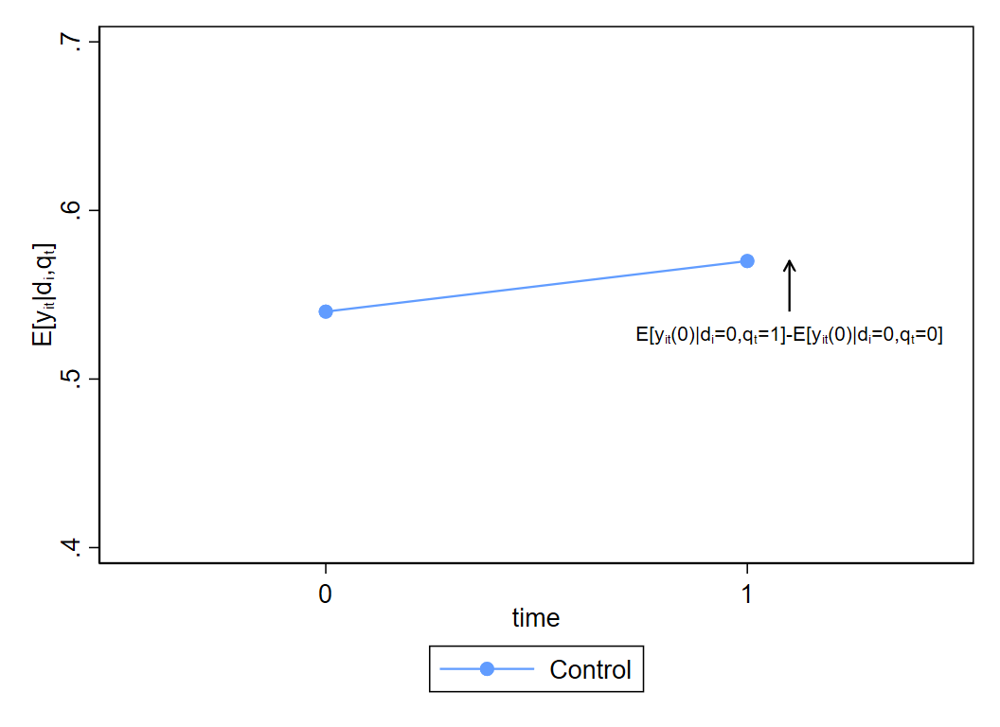{fig-align="center"}

## Treatment vs control

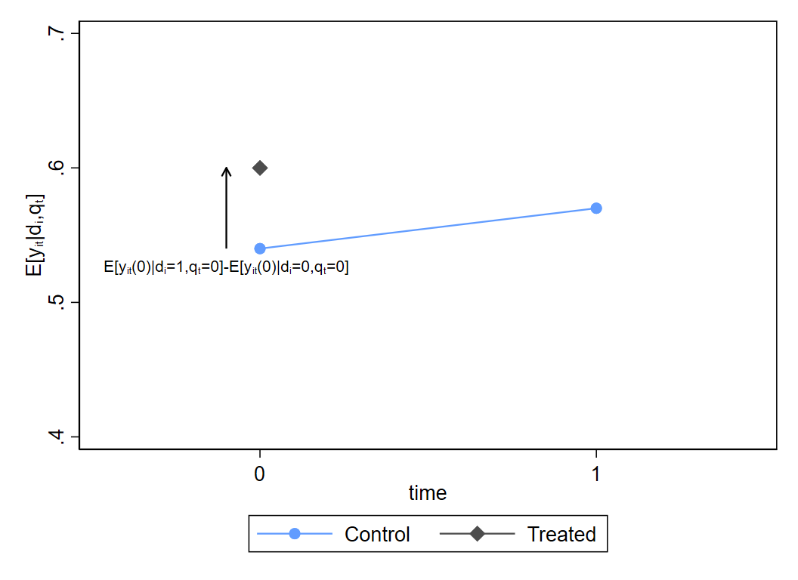{fig-align="center"}

## Parallel trends

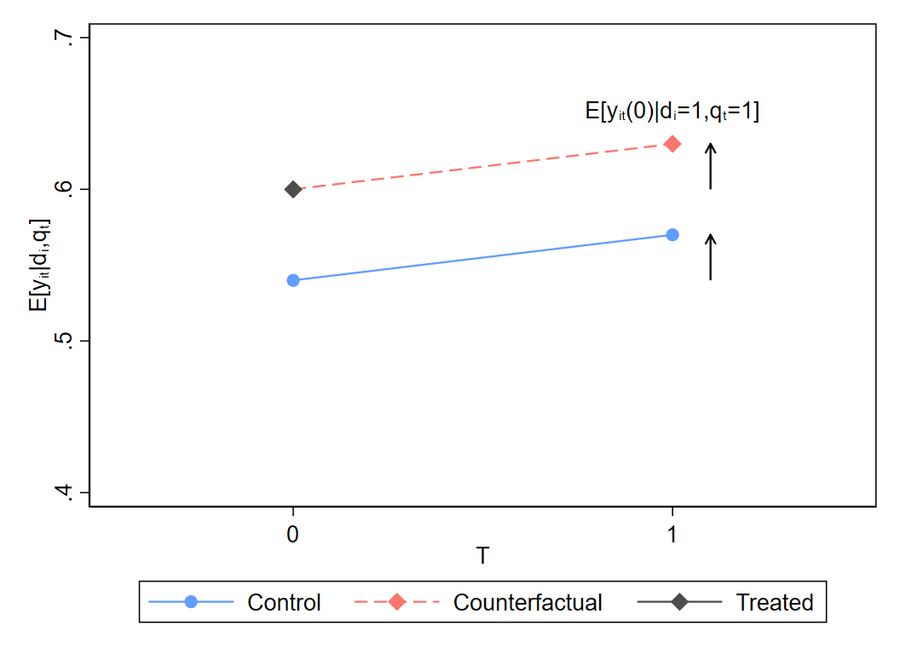{fig-align="center"}

## ATT

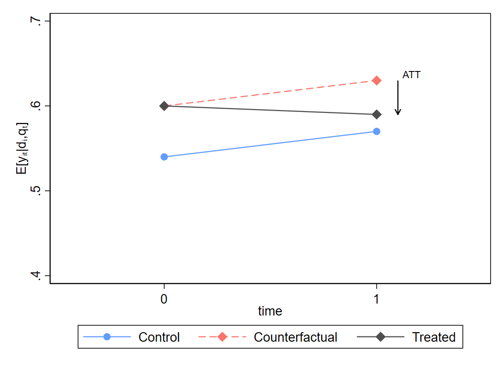{fig-align="center"}

# Linear Model

## Dummy interaction

We will skip the lengthy approach of [Lecture 6](lecture-6-multi.qmd) and consider the model:

$$
  y_{it} = \alpha + \psi d_i + \delta q_t + \beta d_i\times q_t + \varepsilon_{it}
$$

where, $d_i\times q_t$ is an interaction of the two dummy variables. 

## CEFs

Let's consider the CE of $y_{it}$ for combination of $d_i,q_t$

::: incremental

1. $E[y_{it}|d_i=0,q_t=0] = \alpha$

2. $E[y_{it}|d_i=0,q_t=1] = \alpha+\delta$

   - $\Rightarrow \delta = E[y_{it}|d_i=0,q_t=1]-E[y_{it}|d_i=0,q_t=0]$
   
   - $\delta$ captures the mean difference in $y$ in the control group over time. 
   
3. $E[y_{it}|d_i=1,q_t=0] = \alpha+\psi$

   - $\Rightarrow \psi = E[y_{it}|d_i=1,q_t=0]-E[y_{it}|d_i=0,q_t=0]$
   
   - $\psi$ captures the mean difference between treated and control, in the pre-period. 
   
:::

##

4. $E[y_{it}|d_i=1,q_t=1] = \alpha + \psi + \delta + \beta$

   $$
     \begin{aligned}
     \Rightarrow \beta =& \big[\underbrace{E[y_{it}|d_i=1,q_t=1]-E[y_{it}|d_i=0,q_t=1]}_{(\alpha + \psi + \delta + \beta)-(\alpha+\delta)=\beta + \psi}\big] \\
     &-\big[\underbrace{E[y_{it}|d_i=1,q_t=0]-E[y_{it}|d_i=0,q_t=0]}_{(\alpha+\psi)-(\alpha)=\psi}\big]
     \end{aligned}
   $$
   
   - $\beta$ is the DID estimand. 
   
   - $\beta$ is the ATT under assumptions: (1) parallel trends, (2) no anticipation 
   
## Control group

$$
  y_{it} = \alpha + \psi d_i + \delta q_t + \beta d_i\times q_t + \varepsilon_{it}
$$

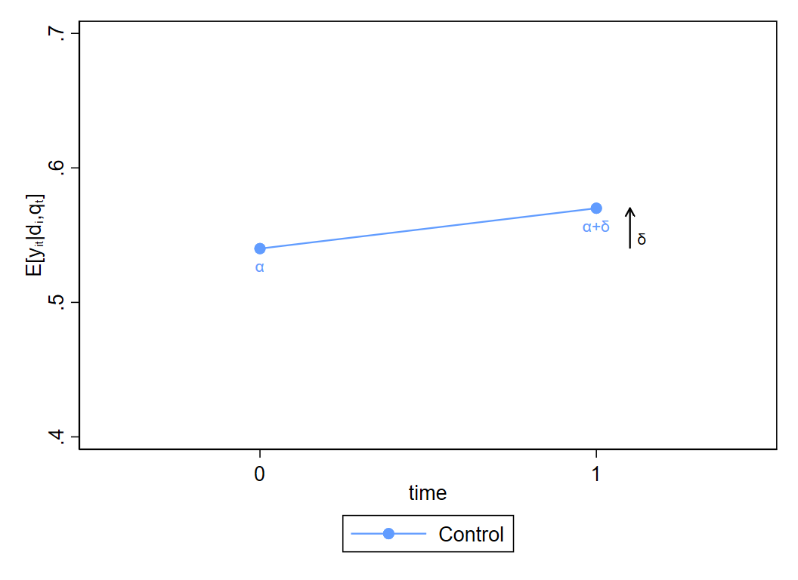{fig-align="center"}

## Treatment vs control

$$
  y_{it} = \alpha + \psi d_i + \delta q_t + \beta d_i\times q_t + \varepsilon_{it}
$$

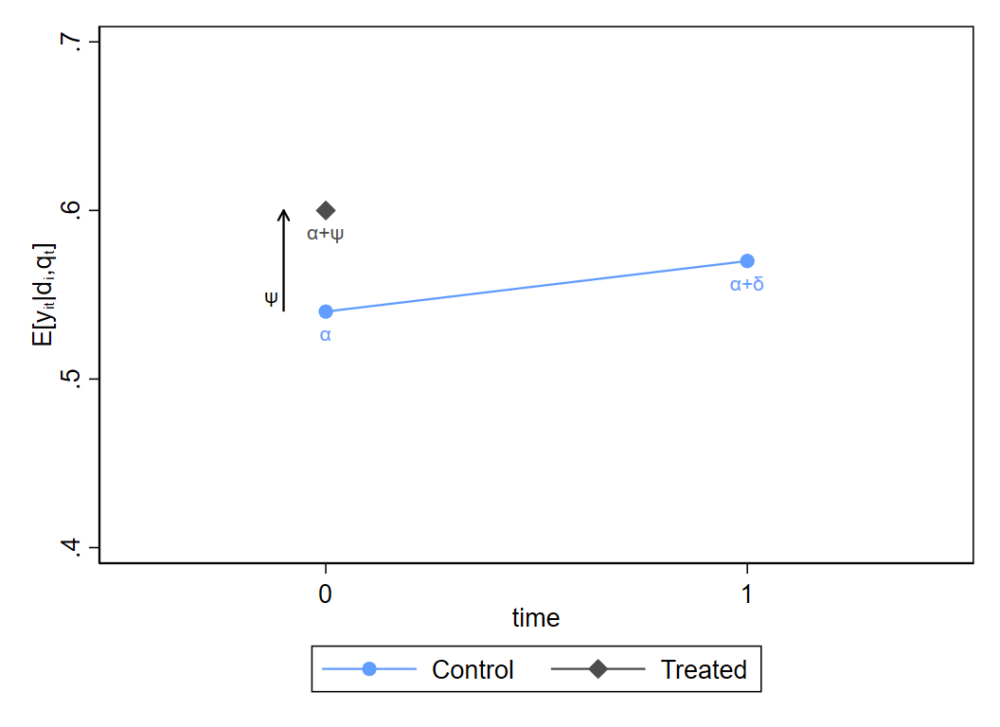{fig-align="center"}

## Parallel trends

$$
  y_{it} = \alpha + \psi d_i + \delta q_t + \beta d_i\times q_t + \varepsilon_{it}
$$

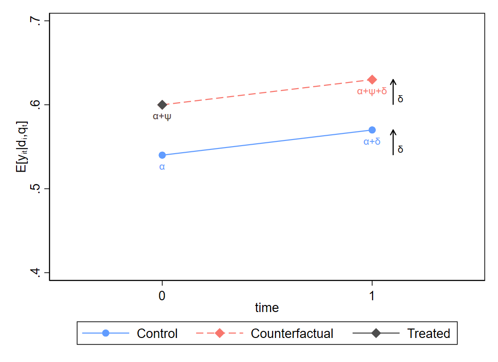{fig-align="center"}

## ATT

$$
  y_{it} = \alpha + \psi d_i + \delta q_t + \beta d_i\times q_t + \varepsilon_{it}
$$

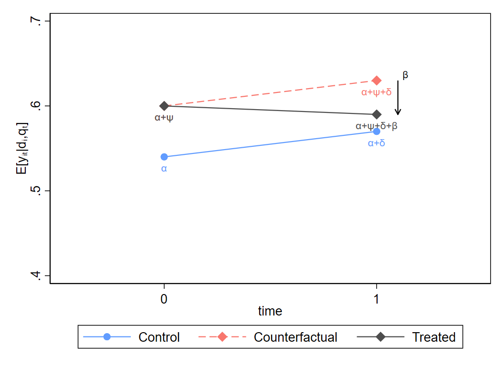{fig-align="center"}  
   
## ATT vs ATE

So, under parallel trends and no anticipation:

$$
  y_{it} = \alpha + \psi d_i + \delta q_t + \tau_{att} d_i\times q_t + \varepsilon_{it}
$$
   
**Why ATT and not ATE?**

- You need unconfoundedness to learn about the ATE. 

- Here we are relying on parallel trends as our identifying assumption. 

  - Doesn't rule out selection into treatment
  
  - But rather assumes selection is time-invariant
  
## Covariates

What if you add covariates?

$$
  y_{it} = \alpha + \psi d_i + \delta q_t + \tau_{att} d_i\times q_t + \mathbf{x}_{it}\gamma + \upsilon_{it}
$$

- They must be "good" controls

- Should improve power (as with RCT)

- Likely correlated with $d_i$, potentially $q_t$

- Unlikely to be correlated with $d_i\times q_t$

  - unless: outcomes of experiment
  
  - if correlated (i.e. estimates change a lot after adding controls), you should ask why?
  
# Example: MW

## MW debate

There has been a extended debate in the labour economic literature on the impact of Minimum Wages:

- Pre-1990’s literature:
  
  - Mostly supported the idea that an higher minimum wages reduce employment.
  
  - Wellington (1991) & Brown et al. (1983): 10% increase in minimum wage reduce teen employment by 1%.
  
  - Largely based on time-series evidence (Brown et al., 1982) or cross-country studies.
  
> “Isolating the impacts of labor market institutions is inherently difficult... Identification issues essentially result from the endogeneity of labor market institutions and the interactions between them... makes it difficult to attribute variations in outcomes to the institutions themselves, rather than other features of the societies in which they exist.” Baetcherman (2012)  
  
## Card (1994)

@card1994minimum is a seminal paper in both the MW and "natural experiments" literatures ([available online](https://davidcard.berkeley.edu/papers/njmin-aer.pdf))

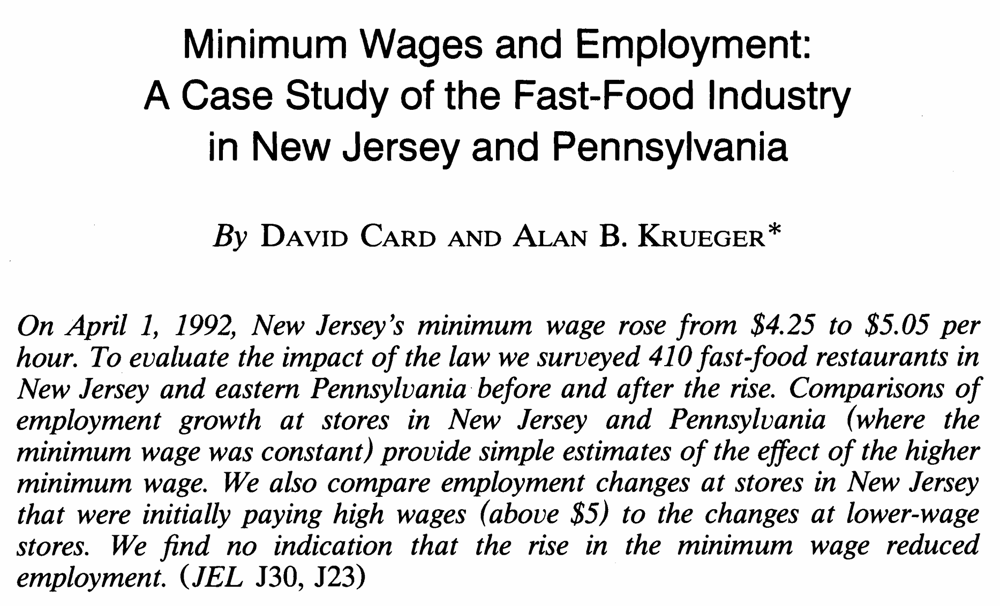{fig-align="center"}

##

Exploit a natural experiment:

- Increase in New Jersey minimum wage from \$4.25 to \$5.05 (19%), April 1992

- Examine the impact on employment at fast food outlets (low wage jobs)

- Use Pennsylvania as a control group in a DiD research design

- **Results**: Find no evidence of a negative employment effect 

- This paper highlights the fact that you can make strong conclusions from what is effectively a very simple research design.

## Institution change

This minimum wage change was not unexpected:

- Federal minimum wage is the floor to all state level minimum wages
- Federal increase from \$3.35 $\rightarrow$ \$3.80 in April 1990
- Federal increase from \$3.80 $\rightarrow$ \$4.25 in April 1991
- New Jersey choose to increase its own minimum wage to \$5.05 effect April 1992, giving it the highest minimum wage in the country.
- Opposed by business leaders, but the opposition lost an appeal (March, 1992) by a close margin.

This last minute appeal and close election do create some uncertainty.

## Card's setup

$$
  d_i = \begin{cases} 
  1\quad \text{if "New Jersey"} \\
  0\quad \text{if "Pennsylvania"}
  \end{cases}
$$

$$
  q_t = \begin{cases} 
  1 \quad \text{if}\;t>\text{April 1992} \\
  0 \quad \text{otherwise}
  \end{cases}
$$

## Data

The authors collect their own data using a phone survey of employers:

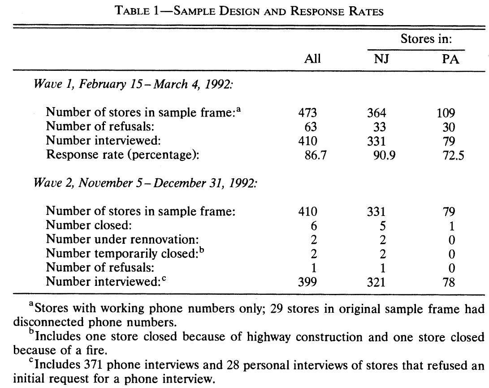{fig-align="center"}

## Pre vs post
In the pre-period the states had similar wage distributions

:::: columns
::: {.column width="50%"}
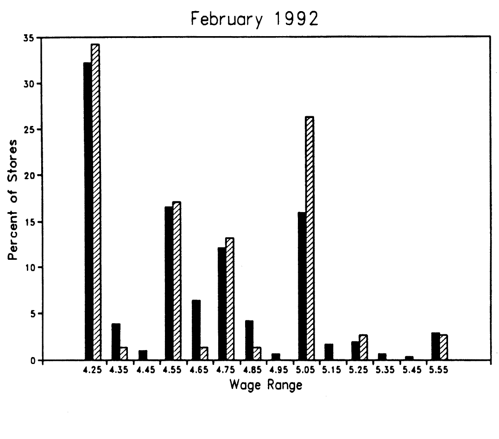{fig-align="center"}
:::
::: {.column width="50%"}
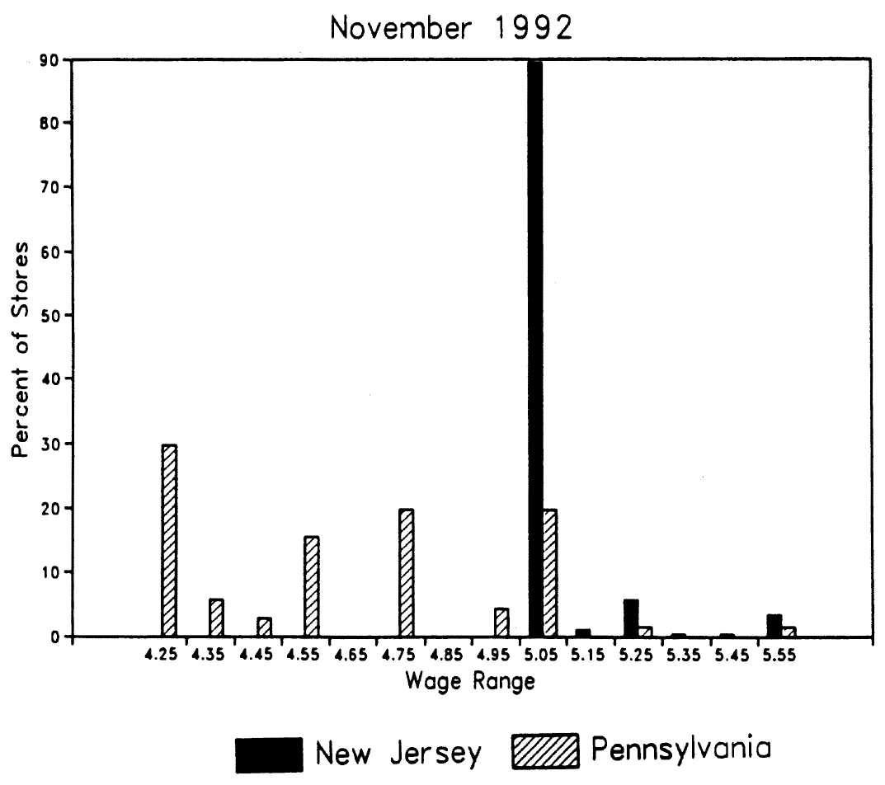{fig-align="center"}
:::
::::

## DID

No evidence of a negative effect, as competitive models would predict.

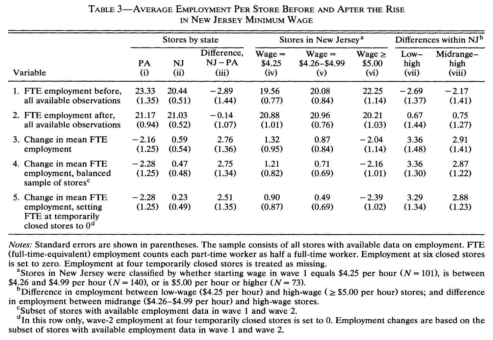{fig-align="center"}
- If anything, some evidence of small positive effect, as suggested by
monopsonistic models.

## MW debate

- Card & Krueger (1994) don’t show pre-trends to help persuade you that the parallel trends assumption is likely to hold.

- After this paper comes the rebuttal by Neumark & Wascher (2000, AER), followed immediately by a response from Card & Krueger (2000, AER).

- This is just round 1 of what is a multi-round debate. The discussion has now shifted away from state-level minimum wages to the study of city-specific policies.

# Modern Application

##

It was 1 January 2018 and Kathleen Wynne was keen to salvage her reelection bid for the premiership of Ontario, Canada. 


##

The governing liberal party announced an unexpected (non-standard) minimum wage increase of \$2.40 (from \$11.60 to \$14, or 21%). With a \$2.25 increase for those under 18 and \$2.10 for liquor servers.  

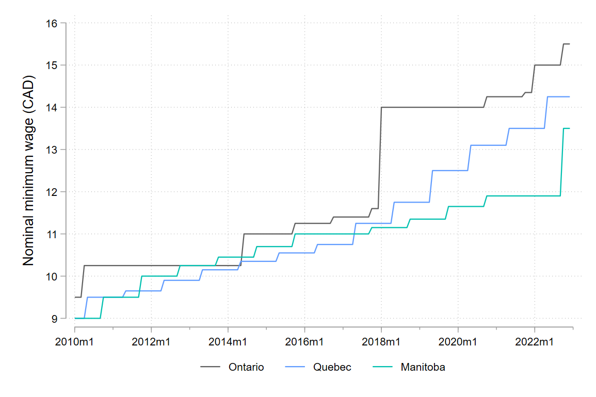{fig-align="center"}

## Set-up

$$
  d_i = \begin{cases} 
  1 \;\text{if "Ontario"}\\
  0 \; \text{if "Quebec" or "Manitoba"}
  \end{cases}
$$

\

$$
  q_t = \begin{cases} 
  1\;\text{if}\;t=2018 \\
  0\;\text{if}\;t=2017
  \end{cases}
$$

## Graphical results

Here I am plotting the employment rate (employment-population ratio) of young individuals aged 15-29

```{stata}
*| include: false
use if inlist(province,5,6,7) using "$data_dir\lfs_2010_2019_ages1564.dta", clear
set scheme plottig
gen employ = empstat<=2 if empstat!=.

```

```{stata}
*| echo: true
*| code-fold: true
*| stata.fig: true
*| fig.align: "center"
*| stata.fig.format: !expr if (knitr::is_latex_output()) "pdf" else "svg"
preserve
qui keep if inlist(agegrp,1,3)
collapse (mean) employ, by(province year)
twoway  (connected employ year if province==6) (connected employ year if province==5, ms(S))  (connected employ year if province==7, ms(D)) if inlist(year,2017,2018), legend(order(1 "Ontario" 2 "Quebec" 3 "Manitoba") r(1) pos(6)) ytitle(Employment rate)  ylabel(0.2(.1).8, format(%2.1f)) xlabel(2017 2018) xmtick(2016.5(.5)2018.5)
restore
```

## Regression

```{stata}
*| echo: true
*| code-fold: true
*| output: false
gen treat = province==6
gen post = year>=2018
gen trtpost = treat*post

gen city = inlist(cma,2,4,9)
tab year city
gen female = sex==2
```

Quebec as control group

```{stata}
*| echo: true
*| code-fold: true
est clear
eststo: qui reg employ treat post trtpost if inlist(province,5,6) & inlist(year,2017,2018) & inlist(agegrp,1,3), r
eststo: qui reg employ treat post trtpost i.month if inlist(province,5,6) & inlist(year,2017,2018) & inlist(agegrp,1,3), r
eststo: qui reg employ treat post trtpost i.month female city i.efamtype i.edugrp if inlist(province,5,6) & inlist(year,2017,2018) & inlist(agegrp,1,3), r

esttab, replace se star(* 0.1 ** 0.05 *** 0.01) keep(_cons treat post trtpost) order(_cons treat post trtpost) indicate("Month FE = 2.month" "Covariates = 2.efamtype") 
```

##

Manitoba as control group

```{stata}
*| echo: true
*| code-fold: true
est clear
eststo: qui reg employ treat post trtpost if inlist(province,7,6) & inlist(year,2017,2018) & inlist(agegrp,1,3), r
eststo: qui reg employ treat post trtpost i.month if inlist(province,7,6) & inlist(year,2017,2018) & inlist(agegrp,1,3), r
eststo: qui reg employ treat post trtpost i.month female city i.efamtype i.edugrp if inlist(province,7,6) & inlist(year,2017,2018) & inlist(agegrp,1,3), r

esttab, replace se star(* 0.1 ** 0.05 *** 0.01) keep(_cons treat post trtpost) order(_cons treat post trtpost) indicate("Month FE = 2.month" "Covariates = 2.efamtype") 
```

##

Manitoba & Quebec as pooled control group

```{stata}
*| echo: true
*| code-fold: true
est clear
eststo: reg employ treat post trtpost if inlist(province,7,6,5) & inlist(year,2017,2018) & inlist(agegrp,1,3), r
eststo: reg employ treat post trtpost i.month if inlist(province,7,6,5) & inlist(year,2017,2018) & inlist(agegrp,1,3), r
eststo: reg employ treat post trtpost i.month female city i.efamtype i.edugrp if inlist(province,7,6,5) & inlist(year,2017,2018) & inlist(agegrp,1,3), r

esttab, replace se star(* 0.1 ** 0.05 *** 0.01) keep(_cons treat post trtpost) order(_cons treat post trtpost) indicate("Month FE = 2.month" "Covariates = 2.efamtype") 
```

# Multi-period DID

## 2 periods

With only 2 periods of data (pre- and post-treatment)

- can't provide evidence that parallel trends holds **in pre-period**

- can't provide evidence that there was no pre-emptive response to the policy/treatment

- can only show the immediate impact on the outcome

  - may under- or over-estimate medium-term impact
  
## Multiple pre-periods

With more pre-treatment data, you can "eye-ball" the treatment and control for evidence of parallel trends and anticipatory responses. 

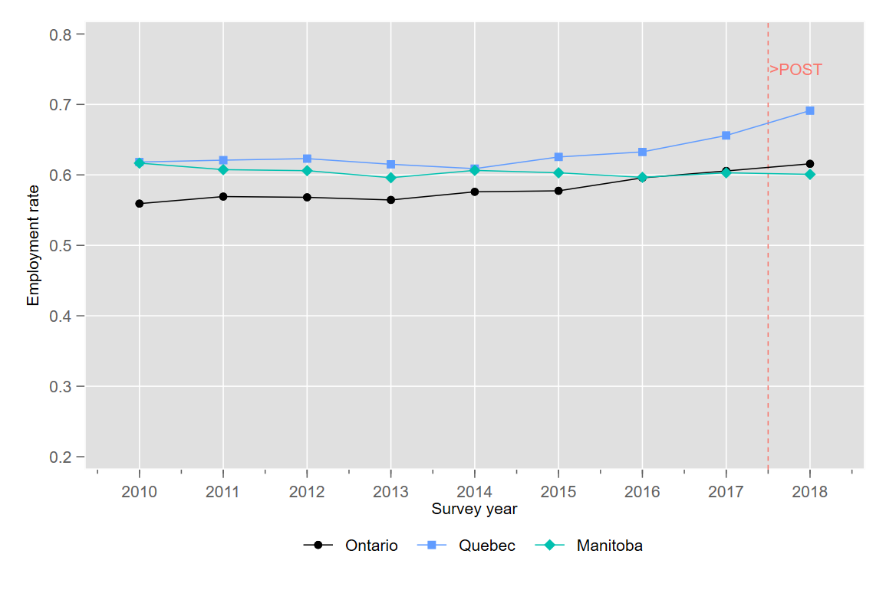{fig-align="center"}  

Reviewing the pre-preiod it looks like something may have happened in Manitoba. 

## Multiple post-periods

With more post-treatment data, we can "eye-ball" whether the divergence was a once-off phenomenon.

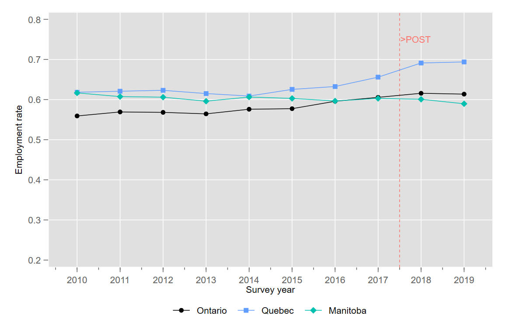{fig-align="center"}  

## 2-period model

You can estimate the same 2-period model with multiple periods of data:

$$
  y_{it} = \alpha + \psi d_i + \delta q_t + \beta d_i\times q_t + \varepsilon_{it}
$$

**However,**

- the model ignores potential heterogeneity

- what if the ATT is different in each post-treatment period?

- is $\beta$ then an average of these post-treatment ATTs?

**This is now a large literature on the complexities of DID models!** Which we won't get into. 

## 

In order to write down a more flexible model, we need a richer notation. 

- Recall: 

  $$
    d_i = \mathbf{1}\{\text{treated}\}\qquad \text{and}\qquad q_t = \mathbf{1}\{t>t_0\}
  $$

- In place of $q_t$ - which identifies the *whole* post-period - we want a variable captures each period relative to the post period. 

  - e.g. if treatment is start of 2018 then 2018 is the first year of treatment, 2019 is the second

## Option 1: Event-time

Define a measure of time, which captures time since the event:

$$
  s = t-t_0
$$

For example, $t_0 = 2018$

- $t=2018\Rightarrow s = 0$; i.e. first year of treatment

- $t=2017\Rightarrow s = -1$; i.e. year preceeding treatment

- $t=2019\Rightarrow s = +1$; i.e. second year since treatment

:::{.callout-note}
This is a very flexible notation that is used in event-study research designs. Also, referred to as staggered DID, these methods are used in settings where different groups are treated in different periods. In these settings, it is standard to define a treatment period for each treatment group: $t_{j0}$. For the never-treated treated control group, this becomes $t_{j0}=\infty$. This trick sets $s = \infty$ for all periods in the never treated control group. 
:::

##

Event-time dummies:

$$
  \mathbf{1}\{s = 0\}
$$

This dummy variable is =1 in the period of the treatment, but 0 otherwise. 

$$
  \mathbf{1}\{s = 1\}
$$

This dummy variable is =1 in the second period since treatment, but 0 otherwise. 

## Option 2: Differences

The same result can be achieved using first-difference notations as well as lags. Consider

$$
  \Delta q_t = q_t - q_t-1
$$

If 

$$
  q_t = \begin{cases} 
  1\;\text{if}\;t\geq 2018 \\
  0\;\text{if}\;t<2018
  \end{cases}
$$

Then, 

$$
  \Delta q_t = \begin{cases} 
  1\;\text{if}\;t= 2018 \\
  0\;\text{otherwise}
  \end{cases}
$$

##

You can define the lag and leads of this variable

- For example, lag 1:

  $$
  \Delta q_{t-1} = q_{t-1} - q_{t-2} = \begin{cases} 
    1\;\text{if}\;t= 2019 \\
    0\;\text{otherwise}
    \end{cases}
  $$

- For example, lead 1:

  $$
  \Delta q_{t+1} = q_{t+1} - q_{t} = \begin{cases} 
    1\;\text{if}\;t= 2017 \\
    0\;\text{otherwise}
    \end{cases}
  $$  

**Both notations are used in the literature.**

## Multi-period models

Suppose $t = 1,\dots,T$, and treatment is in period $t_0$. 

- Event-time ranges from $s = 1-t_0,\dots,-1,0,\dots,T-t_0$

- e.g. in the Canadian data: $t = 2010,\dots,2019;\;s = -8,\dots,1$

##

The model:

$$
  \begin{aligned}
  y_{it} =& \alpha + \psi D_i + \delta q_t +\beta_0 d_i\times\mathbf{1}\{s=0\} \\
  &+ \beta_1d_i\times\mathbf{1}\{s=1\} + \dots + \beta_1d_i\times\mathbf{1}\{s=T-t_0\} + \varepsilon_{it}
  \end{aligned}
$$

\

::: {.fragment .fade-in}
We call this a *semi-dynamic* model and can be written as follows:

$$
  y_{it} = \alpha + \psi D_i + \delta q_t + \sum_{j=0}^{T-t_0}\beta_jd_i\times\mathbf{1}\{s=j\} + \varepsilon_{it}
$$

:::

## Time FEs

If we are going to allow the ATT to vary with each period (post-treatment), we should also allow the control group's time-trend to vary too. 

- This is pinned down by $\delta q_t$ in the model. 

\

::: {.fragment .fade-in}
Including time FEs:

$$
  y_{it} = \delta_t + \psi d_i + \sum_{j=0}^{T-t_0}\beta_jd_i\times\mathbf{1}\{s=j\} + \varepsilon_{it}
$$
:::

## Two-way FEs

**Under parallel trends and no anticipation**, the model implies a **two-way FEs** structure for the CEF of $y(0)$.

$$
  E[y_{it}(0)|t,d_i] =  \delta_t + \psi d_i
$$

- consistent with parallel trends (i.e. $\delta_t$ is common).

::: {.fragment .fade-in}
And,

$$
  \beta_s = \tau_{att}(s) \qquad s = 0,\dots,T-t_0
$$

:::

## Dynamic specification

However, we can make the model even more flexible:

$$
  y_{it} = \delta_t + \psi d_i + \sum_{j=1-t_0}^{-2}\beta_jd_i\times\mathbf{1}\{s=j\}+\sum_{j=0}^{T-t_0}\beta_jd_i\times\mathbf{1}\{s=j\} + \varepsilon_{it}
$$

::: {.fragment .fade-in}
OR, combining these:

$$
  y_{it} = \delta_t + \psi d_i + \sum_{j\neq-1}\beta_jd_i\times\mathbf{1}\{s=j\} + \varepsilon_{it}
$$

- you MUST exclude at least one interaction (otherwise perfectly collinear with $d_i$)

- typical to exclude -1, as period of normalization

:::

## Leads

What should we make of,

$$
  \beta_s \qquad\text{for}\; s=1-t_0,\dots,-2
$$

\

::: incremental

- These are DID estimads for the **pre-period**

- **Under parallel trends, they should be =0**

- Test for parallel trends:

  $$
    H_0: \beta_{1-t_0}=\dots=\beta_{-2}=0
  $$

:::

## Panel vs Pooled

With panel data, you can include unit FEs:

$$
  y_{it} = \alpha_i + \delta_t + \sum_{j=0}^{T-t_0}\beta_jd_i\times\mathbf{1}\{s=j\} + \varepsilon_{it}
$$

- But this is not needed for identification!

- The unit FEs absorb $\psi d_i$, as it is time-invariant. 

- Unit/individual FEs **tend to** explain a large share of the variation in $y$, leading to more precise estimates. 

## Group assignment

What is quite common is for the treatment to be assigned at the "group" level, 

- for example, provincial policies in the Canada

  $$
    d_i = d_g
  $$
  
::: {.fragment .fade-in}

You can then include group FEs in the estimation, which absorb $\psi d_p$

$$
  y_{it} = \delta_t + \psi_g + \sum_{j\neq-1}\beta_jd_g\times\mathbf{1}\{s=j\} + \varepsilon_{it}
$$

- when treatment is assigned at a group level, it is standard to cluster SEs at the group level

- although, cluster corrections require a *sufficiently large* number of clusters

:::

## Example

In this setting there is a one-to-one mapping between event-time and time. So, we can estimate:

```{stata}
*| echo: true
reg employ i.treat##ib2017.year if inlist(province,5,6) & inlist(agegrp,1,3), robust
```

## Plotting coefficients

```{stata}
*| echo: true
*| code-fold: true
*| stata.fig: true
*| fig.align: "center"
*| stata.fig.format: !expr if (knitr::is_latex_output()) "pdf" else "svg"
cap prog drop graphprep
program def graphprep
args mod start end base treat prefix suffix
	quietly{
		cap drop `mod'*
		gen `mod' = .
		gen `mod'_up = .
		gen `mod'_lo = .
		gen `mod'_t = .
		local n = 1
		forvalues i = `start'/`end' {
			if `i'!=`base' {
			local var `prefix'`i'`suffix'
			replace `mod' = _b[`var'] in `n'
			replace `mod'_up = _b[`var']+invttail(e(df_r),0.5*(1-c(level)/100))*_se[`var'] in `n'
			replace `mod'_lo = _b[`var']-invttail(e(df_r),0.5*(1-c(level)/100))*_se[`var'] in `n'
			}
			else replace `mod' = 0 in `n'
			replace `mod'_t = `i'-`treat' in `n'
			local n = `n'+1
		}
	}
end

graphprep mod1 2010 2019 2017 2018 1.treat# .year

	twoway (rcap mod1_up mod1_lo mod1_t,  lc(black)) (connected mod1 mod1_t, lc(plb1) mc(black) ms(o)), ytitle("Change in outcome") ylabel(-0.04(0.02)0.04, format(%3.2f))  yline(0, lc(plr1) lp(solid)) xtitle("Event-time") xlabel(-8(1)1) xline(-0.5, lc(black*.80%50) lp(dash)) title("Dynamic specification") subtitle("Using Quebec as control, without covariates") legend(off) text(.03 -.5 ">POST", place(E) color(plr1) size(small))

```

## Adding covariates

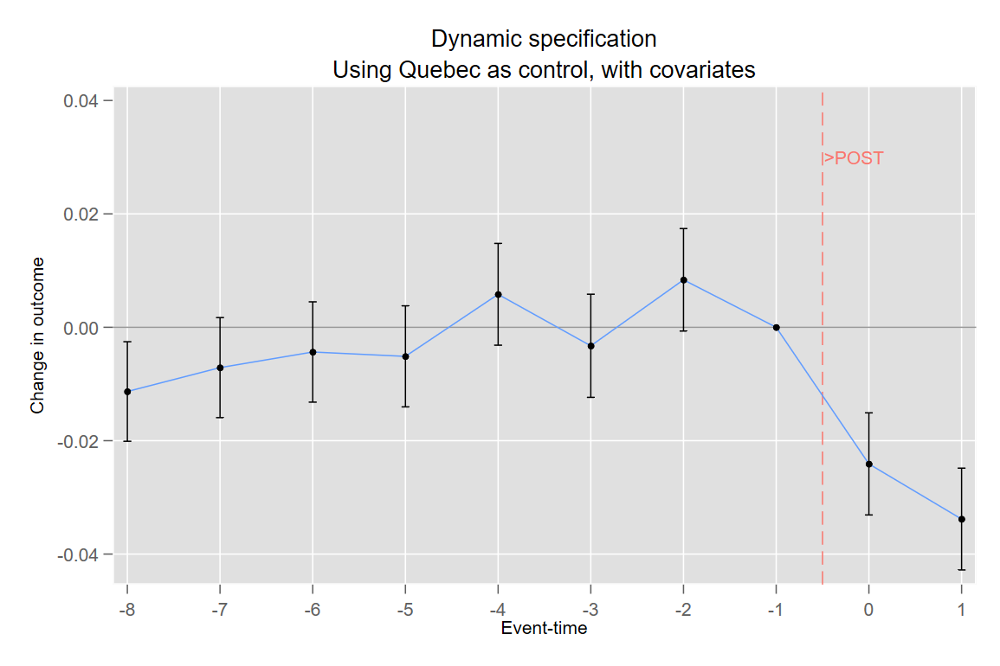{fig-align="center"}  

## Alternate control group

Using Manitoba as a control, we see strong evidence of a violation of parallel trends. 

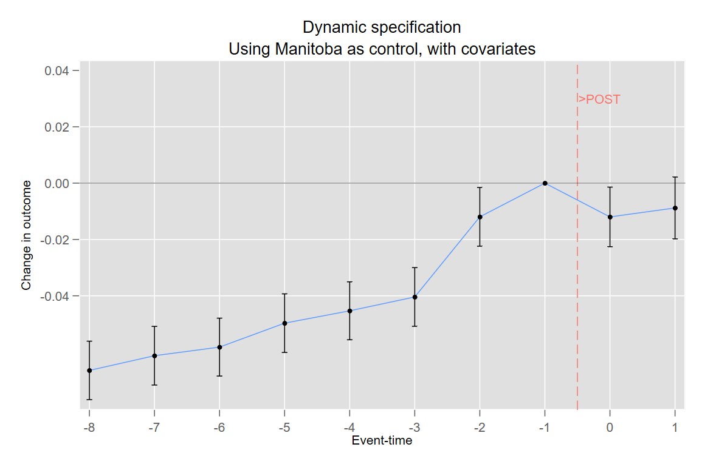{fig-align="center"}  

## Placebo

We could examine whether there is an effect for older workers. 

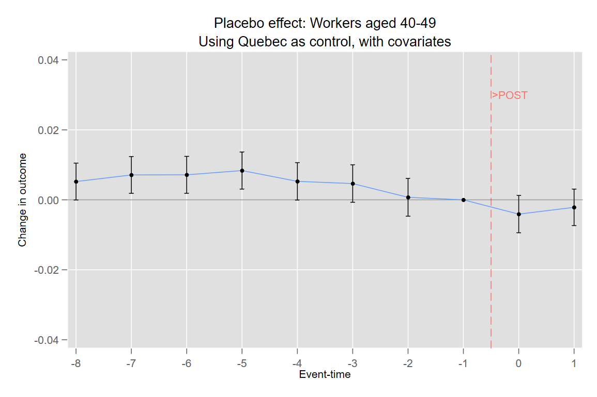{fig-align="center"}  

# References

## Bibliography
